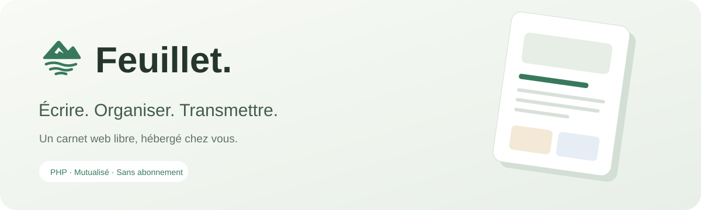

  

<h1 align="center">Vos notes. Votre espace.</h1>

  <strong>Un carnet web gratuit et open source pour donner une place à vos idées.</strong> 
  Écrivez, organisez vos documents et partagez ce qui compte, 
  depuis votre propre hébergement, sur ordinateur comme sur mobile.

  
  
  

  <a href="https://github.com/monsieur-de-paz/feuillet/releases/latest"><strong>Télécharger Feuillet →</strong></a>
  &nbsp; · &nbsp;
  <a href="#installation">Installer</a>
  &nbsp; · &nbsp;
  <a href="#fonctionnalités">Fonctionnalités</a>
  &nbsp; · &nbsp;
  <a href="docs/NOUVEAUTES-0.31.md#aperçus-sur-données-fictives">Voir les aperçus</a>

 

| Écrire librement | Tout rassembler | Partager simplement |
| :--- | :--- | :--- |
| Composez vos pages avec des blocs, des tableaux, des images et des médias. | Retrouvez vos notes, fichiers et bases de données dans vos carnets. | Publiez une page, partagez son lien ou recueillez des réponses par formulaire. |

Feuillet fonctionne sur un hébergement mutualisé compatible, **sans VPS ni abonnement**. Un seul compte administrateur rédige ; les lecteurs consultent les pages publiées et répondent aux formulaires sans créer de compte.

## Installation

Un hébergement **PHP 8.3+**, une base **MySQL/MariaDB** et **HTTPS** suffisent, y compris sur un mutualisé compatible. Aucun VPS, abonnement, Composer ou Node.js n’est nécessaire pour installer la distribution. SQLite est également disponible sur les hébergements compatibles.

1. Téléchargez l’archive **`Feuillet-x.y.z.zip`** dans la [dernière release](https://github.com/monsieur-de-paz/feuillet/releases/latest), plutôt que le ZIP « Source code ». L’interface est déjà compilée.
2. Décompressez-la et envoyez **tout le dossier `feuillet/`** par FTP/SFTP, y compris les fichiers cachés `.htaccess`.
3. Faites pointer votre domaine ou sous-domaine vers **`feuillet/public`**, puis activez HTTPS. Les dossiers `app/`, `storage/` et le fichier `config.php` doivent rester hors de la racine web.
4. Créez une base SQL dédiée et conservez son serveur, son nom, son utilisateur et son mot de passe.
5. Ouvrez **`https://votre-domaine.fr/setup.php`**. À cette première ouverture, Feuillet crée une clé dans **`storage/installation-key.txt`** : lisez-la par FTP, saisissez-la dans l’installateur, puis configurez votre carnet, le compte administrateur et la base.

L’installateur vérifie les extensions PHP, les sessions et les droits d’écriture nécessaires. Le compte d’hébergement doit pouvoir créer `config.php` et écrire dans `storage/`.

**Besoin d’aide ?** Le [guide OVH pas à pas](docs/INSTALLATION-OVH.md) détaille les prérequis, le sous-domaine, la base SQL et les vérifications après installation.

## Fonctionnalités

- **Écrire par blocs** : commandes `/`, titres dépliables, listes, tableaux, colonnes, encadrés, boutons et déplacement de plusieurs blocs.
- **Organiser ses notes** : carnets, catégories, pages et sous-pages, recherche, onglets de rédaction et historique.
- **Rassembler ses médias** : images, PDF, audio, vidéos, bibliothèque de fichiers et de vidéos en ligne, aperçus de liens et intégrations web.
- **Créer des bases** : champs typés, vues en tableau ou galerie, tri, filtres, regroupements, relations, formules et agrégations.
- **Recueillir des réponses** : formulaires avec dépôt de fichiers, cinq modèles, textes personnalisables, aperçu en direct et animations. Réponses privées et projection administrateur actualisée toutes les dix secondes.
- **Partager à son rythme** : pages privées ou publiques, liens personnalisés, partage des sous-pages et accueil public configurable.
- **Personnaliser son espace** : interface Rivage, thèmes clair, sombre et OLED, couleurs, polices, icônes et couvertures repositionnables.
- **Utiliser Feuillet sur mobile** : interface adaptée, installation comme application web et cache facultatif des pages publiques pour la lecture hors connexion.
- **Conserver ses données** : import TXT, Markdown et RTF ; export Markdown et PDF ; sauvegarde et restauration ZIP.

## Mises à jour et documentation

Les mises à jour s’installent depuis Feuillet, à partir des releases GitHub, avec sauvegarde et récupération en cas d’échec. Pour une mise à jour manuelle, **conservez `config.php` et tout le dossier `storage/`**. [Procédure et restauration](docs/MISES-A-JOUR.md).

- [Bases de données et formulaires](docs/BASES-ET-FORMULAIRES.md)
- [Édition et présentation des blocs](docs/BLOCS-0.4.md)
- [Maintenance et sauvegardes](docs/MAINTENANCE.md)
- [Historique des versions](CHANGELOG.md)

## Contribuer

Une idée ou un problème ? Ouvrez une [issue](https://github.com/monsieur-de-paz/feuillet/issues) ou proposez une pull request. Le projet utilise **PHP, React, TypeScript et le cœur libre de Tiptap**. Voir l’[architecture](docs/ARCHITECTURE.md) et les [tests](docs/TESTS.md). Pour une faille de sécurité, suivez la [procédure de signalement](.github/SECURITY.md).

Créé par **Monsieur de PAZ, enseignant en France**. Distribué sous [licence MIT](LICENSE) ; les dépendances conservent leurs [licences respectives](THIRD-PARTY-NOTICES.md).
