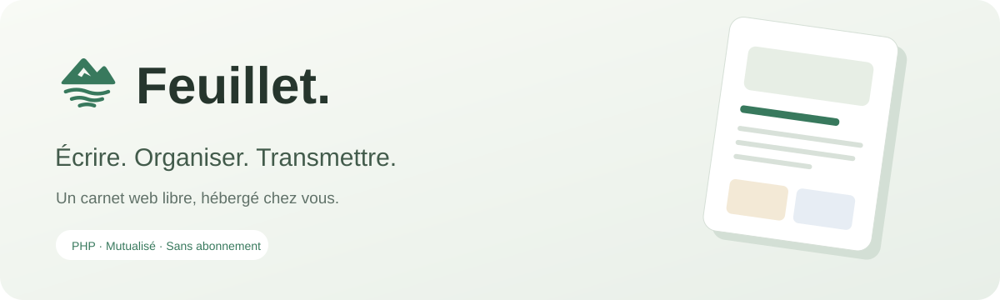
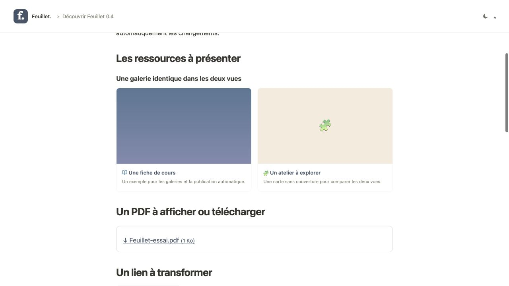
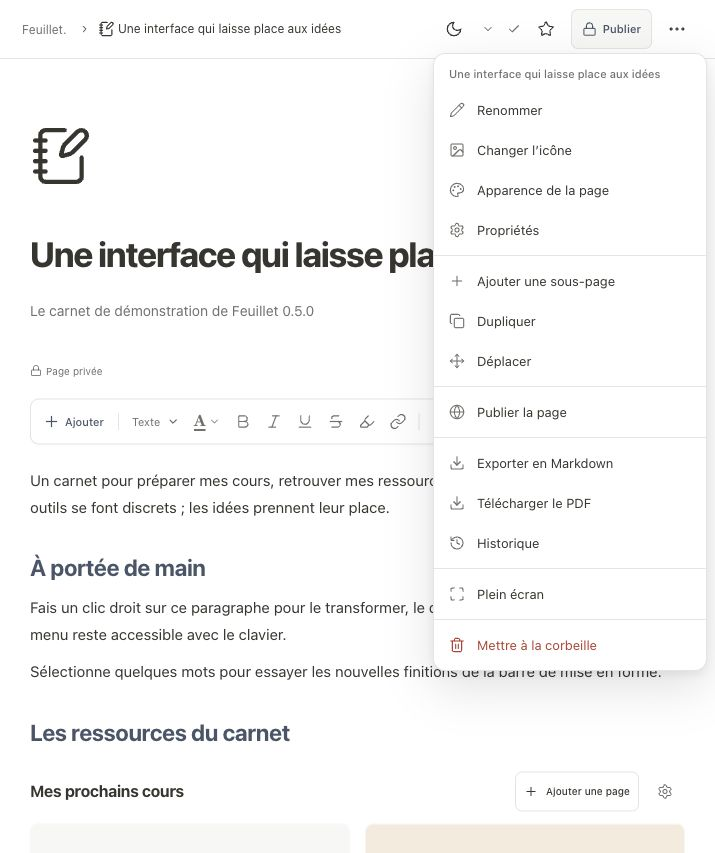

<p align="center"></p>

<p align="center">
  <a href="LICENSE"></a>
  
  
  
</p>

**Feuillet est un carnet web gratuit et open source pour prendre des notes enrichies, les centraliser et les partager sur son propre hébergement.** Inspiré de l’édition par blocs, il permet de rédiger des notes enrichies, conserver des notes privées, publier des PDF et recevoir des réponses à des formulaires.

Il fonctionne sur un hébergement **PHP + MySQL/MariaDB**, y compris un mutualisé compatible. Un seul compte rédige ; les lecteurs consultent les pages et répondent aux formulaires depuis leur navigateur, sur ordinateur ou mobile. Aucun VPS ni abonnement n’est nécessaire. Node.js sert uniquement à développer l’interface ; les fichiers compilés sont fournis.

<p align="center"><a href="https://github.com/monsieur-de-paz/feuillet/releases/latest"><strong>Télécharger Feuillet</strong></a> · <a href="#installer-sur-un-hébergement">Installer</a> · <a href="docs/BASES-ET-FORMULAIRES.md">Bases et formulaires</a> · <a href="docs/NOUVEAUTES-0.11.md">Nouveautés</a></p>

Un journal personnel, un espace de projets, une collection de lectures ou une documentation : vous choisissez vos carnets, leurs catégories et ce que vous partagez.

## Ce que vous pouvez faire

| Écrire | Organiser | Transmettre |
|---|---|---|
| Éditeur par blocs, commandes `/`, titres dépliables, listes, tableaux, colonnes et encadrés | Carnets, catégories personnalisées, pages et sous-pages, fil d’Ariane | Publication d’une page et de ses sous-pages |
| Couleur du texte et du fond, liens, boutons modifiables | Galeries de pages et bases avec champs typés | PDF, audio, vidéo et fichiers à télécharger |
| Couvertures repositionnables, icônes importées, images redimensionnables et agrandissables dans l’éditeur | Relations entre bases, formules et agrégations | Quiz avec correction immédiate |
| Thèmes blanc, sombre et OLED ; polices Quicksand et Fraunces | Notes privées, recherche et historique | Formulaires : texte, e-mail, téléphone, URL, fichiers… |
| Import et export Markdown, export PDF | Partage par branche, sauvegarde et restauration ZIP | Réponses aux formulaires consultables uniquement par l’administrateur |

<details>
<summary>Voir un exemple de lecture publique</summary>



</details>

Le cœur libre de **Tiptap** est utilisé pour l’édition. Les menus, blocs et fonctions de Feuillet sont développés dans ce dépôt ; aucun template commercial ou composant Tiptap Pro n’est requis. Feuillet est indépendant de Notion.

Cliquez sur le logo pour retrouver toutes vos activités, ou sur un carnet pour ouvrir son accueil : pages récentes, catégories, recherche et liste de toutes ses pages. Les actions de création et d’import utilisent le carnet sélectionné. Cliquez directement sur son titre ou son icône pour les modifier, et ajoutez une couverture repositionnable depuis cet accueil. Le panneau de publication permet de copier le lien public ou de le partager avec les applications proposées par votre appareil.

## Une interface de carnet



Sélecteurs avec recherche, menus d’actions au clic droit ou par bouton, navigation compacte et thème personnel clair/sombre/OLED. Les menus restent utilisables au clavier et s’adaptent aux petits écrans. La version 0.5.1 harmonise les marges des dialogues, remplace les cadres de sélection par un accent doux et permet un partage sans accueil général. [Nouveautés 0.5](docs/NOUVEAUTES-0.5.1.md) · [Charte graphique](docs/CHARTE-GRAPHIQUE.md).

## Installation et mises à jour

La version 0.8 propose un installateur en trois étapes, adapté au mobile, et des mises à jour depuis les releases GitHub : notification discrète, report, attente de la suivante, exclusion d’une version ou désactivation. L’installation sauvegarde le code et la base puis contrôle le démarrage ; les échecs déclenchent une restauration. Les releases publiques sont accessibles sans clé ni compte GitHub. La version 0.11 utilise leurs téléchargements directs pour éviter le quota anonyme de l’API REST. [Nouveautés 0.8](docs/NOUVEAUTES-0.8.md) · [Guide des mises à jour](docs/MISES-A-JOUR.md).

## Installer sur un hébergement

### 1. Vérifier les prérequis

| Prérequis | Usage |
|---|---|
| PHP **8.3 ou plus récent**, dans une version maintenue | Exécution du logiciel |
| MySQL ou MariaDB, avec une base dédiée et son utilisateur | Pages, réglages et bases de données |
| Extensions `PDO`, `pdo_mysql`, `mbstring`, `fileinfo`, `zip` | Accès SQL, textes, médias et sauvegardes |
| Sessions PHP et dossiers inscriptibles par le compte de l’hébergement | Connexion et stockage privé |
| HTTPS | Accès au carnet et aux formulaires |
| Extension `curl` et HTTPS sortant vers Wikimedia Commons / GitHub | Recherche d’images et mises à jour depuis les releases |

SQLite est aussi disponible avec `pdo_sqlite` pour une installation locale ou un hébergement compatible. Choisir MySQL/MariaDB sur un mutualisé proposant une base SQL.

### 2. Télécharger et transférer le logiciel

Télécharger **`Feuillet-0.11.0.zip`** depuis [les versions publiées](https://github.com/monsieur-de-paz/feuillet/releases), puis décompresser l’archive et envoyer tout le dossier `feuillet` par FTP/SFTP. Afficher les fichiers cachés pour transférer également les `.htaccess`.

Utiliser l’archive installable de la release : elle contient les assets compilés et le manifeste nécessaire aux mises à jour intégrées. Le ZIP automatique « Source code » n’est pas la distribution recommandée.

```text
feuillet/
├── app/                 code PHP interne
├── public/              SEULE racine web
│   ├── assets/          interface déjà compilée
│   ├── fonts/           polices hébergées localement
│   ├── vendor/          lecteur PDF
│   ├── index.php
│   └── setup.php
├── storage/             médias, sessions et stockage privés
└── config.php           créé par l’installation ; jamais dans GitHub
```

**La racine web du domaine doit pointer vers `feuillet/public`.** Les dossiers `app`, `storage` et le fichier `config.php` restent en dehors de cette racine. Ne pas déplacer leurs fichiers dans `public`.

Le compte d’hébergement doit pouvoir créer `config.php` dans `feuillet/` et écrire dans `storage/`. Utiliser les droits du propriétaire prévus par l’hébergeur ; `777` n’est pas nécessaire.

### 3. Configurer le domaine et la base

Créer une base SQL dédiée. Conserver le **serveur SQL exact**, le port, le nom de la base, l’utilisateur et son mot de passe. Feuillet crée ses tables ; aucun import SQL manuel n’est nécessaire.

Associer le domaine ou sous-domaine au dossier `feuillet/public`, activer HTTPS et sélectionner la version PHP adaptée. Exemple : `notes.exemple.fr` → `feuillet/public`.

**Sur OVHcloud**, utiliser **Hébergement → Multisite** pour associer le sous-domaine au dossier racine. Les réglages PHP dépendent de la configuration de l’offre ; consulter le [guide OVHcloud](docs/INSTALLATION-OVH.md) et sa [documentation officielle PHP](https://docs.ovhcloud.com/fr/guides/web-cloud/web-hosting/configure-your-web-hosting). Les limites de PHP et de la base sont distinctes de l’espace de stockage.

### 4. Ouvrir l’installateur

Ouvrir `https://notes.exemple.fr/setup.php`, puis :

1. Vérifier les prérequis affichés. À la première ouverture, l’installateur crée une clé privée dans `storage/installation-key.txt`.
2. Lire ce fichier par FTP/SFTP, puis saisir sa clé dans le champ **Clé d’installation**. Elle n’est jamais affichée par le site et sera supprimée après installation.
3. Choisir le nom du carnet et un mot de passe administrateur d’au moins 12 caractères.
4. Choisir MySQL/MariaDB et renseigner les paramètres fournis par l’hébergeur.
5. Cliquer sur **Créer mon carnet**.

La configuration est créée automatiquement. Il n’y a aucun compte ou mot de passe prédéfini. Le carnet démarre sans les pages et données de démonstration du développement. Aucune commande SSH, installation Composer ou compilation n’est nécessaire pour cette installation.

### 5. Préparer ses carnets et essayer avant de partager

Créer des **Carnets** pour organiser les pages et leurs catégories. Pour partager une page, publier sa page puis copier son lien public. Cette page devient la première de la navigation du visiteur ; ses liens et galeries restent dans sa branche. Une sous-page partagée directement devient sa propre racine. L’adresse `index.php?read=1` ne liste aucune page. Les pages publiques restent consultables par toute personne possédant leur lien : cette navigation ne constitue pas un accès protégé par groupe. [Guide de partage 0.5.1](docs/NOUVEAUTES-0.5.1.md).

Créer une page, y déposer un petit PDF, puis cliquer sur **Publier**. Dans une fenêtre privée du navigateur, vérifier la lecture et le téléchargement. Repasser la page en privé et vérifier l’accès au lien du fichier. Un média réutilisé dans une autre page publique reste accessible.

La version a été testée localement sur SQLite et MySQL. La configuration exacte du serveur de chaque hébergeur, ses limites PHP et ses performances doivent être vérifiées à l’installation ; le compte OVH de production n’a pas servi aux essais.

## Navigation, texte et bibliothèque

Le bouton à droite du titre du site masque la barre latérale ; un bouton dans l’en-tête la réaffiche. Le raccourci initial est **Ctrl/Cmd + Maj + L**. Dans **Réglages & sauvegardes → Mon carnet**, choisir une autre touche ou désactiver ce raccourci. Le masquage est mémorisé dans le navigateur.

L’accent général possède des variantes automatiques pour les thèmes sombre et OLED, également appliquées dans la vue publique. Dans les outils de couleur, **Texte par défaut** suit le thème clair, sombre ou OLED. Les couleurs choisies explicitement restent fixes. Pour une propriété **État / Choix unique** ou **Choix multiples**, ouvrir le menu de colonne puis **Modifier la propriété** pour attribuer une couleur à chaque choix.

Dans **Bibliothèque**, le bouton **Utilisations** de chaque fichier liste ses pages, bases, galeries et anciennes versions, avec leur état public ou privé. Il distingue le brouillon et le fichier réellement publié. Cet inventaire est réservé à l’administrateur. [Guide 0.4.1](docs/NOUVEAUTES-0.4.1.md).

## Les premières commandes

| Commande | Résultat |
|---|---|
| `/titre` | Choisir un titre de niveau 1, 2 ou 3 |
| `/page` | Créer une sous-page et saisir immédiatement son titre |
| `/galerie` | Insérer une collection de pages à composer |
| `/pdf`, `/image`, `/audio`, `/vidéo` | Ajouter un média ou un document |
| `/bouton` | Ajouter un bouton dont le texte et le lien restent modifiables |
| `/base` | Créer ou choisir une base de données |
| `/formulaire` | Créer ou choisir un formulaire lié à une base |
| `/quiz` | Ajouter un quiz avec correction |

Le bouton **Ajouter** propose les mêmes insertions sur mobile. Sélectionner du texte ouvre les outils de mise en forme. Le nom, le sous-titre, la limite d’envoi et le thème général se règlent dans **Réglages & sauvegardes**. Les propriétés d’une page permettent de personnaliser son apparence et sa catégorie. Le bouton **Présentation** transforme les fichiers déjà présents en lecteurs ou téléchargements, et les liens en boutons ou cartes. [Modifier les blocs](docs/BLOCS-0.4.md).

## Comprendre ce qui est public

Les nouvelles pages racines sont **privées**. **Publier** partage cette page et toutes ses sous-pages actuelles. Ensuite, par défaut, chaque enregistrement actualise automatiquement une page déjà publique, y compris les médias et la couverture. Le réglage **Publier automatiquement les sous-pages des pages publiques** rend publiques toutes leurs sous-pages existantes et futures, y compris lors d’un déplacement sous un parent public. Il est désactivé par défaut pour conserver les choix de visibilité existants. Une fois activé, l’accès public est hérité du parent ; désactiver ce réglage ou rendre le parent privé permet de préparer des sous-pages privées. **Rendre privée** retire aussi les sous-pages.

Décocher **Mettre à jour automatiquement les pages déjà publiques** dans les réglages retrouve le mode brouillon et sa publication manuelle. Les visiteurs déjà présents suivent les changements toutes les 15 secondes lorsque leur onglet est visible. Un quiz commencé ou un média en lecture est préservé. [Fonctionnement détaillé](docs/PUBLICATION-ET-THEMES-0.4.md).

Les cartes de galerie partagent le même ratio, la même disposition et les mêmes tailles dans les deux vues ; les contrôles et pages privées restent réservés à l’administrateur. L’icône du carnet et celle d’une page se modifient avec un catalogue d’émojis, les dessins Lucide colorables ou une image. Le bouton de thème personnel propose clair, sombre et OLED ; il est adapté à l’ordinateur et au mobile.

Le tri, les filtres et les colonnes affichées se règlent indépendamment dans chaque vue liée. Les cellules s’éditent directement ; une relation sélectionne des fiches de la base cible. **Les filtres et colonnes masquées sont des réglages de présentation : ils ne protègent pas des données.** Rendre privées les fiches ou bases à cacher.

Une base possède sa propre visibilité : elle doit être publique **et** intégrée à une page publiée pour être accessible aux lecteurs. Les formulaires peuvent être partagés par leur lien. Leurs réponses et fichiers restent privés, même si le formulaire ou la base est public. Un lecteur n’a pas besoin de compte pour envoyer une réponse.

Les pages publiques sont accessibles à toute personne disposant du lien. Les quiz conviennent à l’entraînement : ils ne conservent pas les résultats individuels et ne constituent pas un système d’examen sécurisé.

## Sauvegarder et mettre à jour

Exporter régulièrement le carnet depuis **Réglages & sauvegardes**. Le ZIP contient les pages, médias, espaces, catégories, réglages, bases et réponses aux formulaires. **Cette sauvegarde contient vos données privées** : la conserver hors du dépôt GitHub.

L’import crée des copies privées, conserve les relations et calculs, remappe les fichiers et ferme les formulaires importés. Le ZIP ne remplace pas une sauvegarde complète de la base SQL, de `config.php` et de `storage/`, nécessaire pour restaurer aussi le compte et l’historique technique.

Pour une mise à jour : sauvegarder, remplacer le code et le contenu de `public/assets/`, conserver **`config.php` et tout `storage/`**, puis ouvrir le carnet. Les migrations sont automatiques et ne suppriment pas les pages. Vérifier ensuite connexion, lecture publique et accès aux fichiers. Ne pas relancer l’installateur sur une installation existante.

## Limites actuelles

- Un seul compte administrateur ; pas de collaboration simultanée ni de comptes visiteurs.
- Les formules utilisent le langage propre à Feuillet ; il couvre calculs, conditions, textes et agrégations, sans reprendre toute la syntaxe de Notion. [Syntaxe et exemples](docs/BASES-ET-FORMULAIRES.md).
- Jusqu’à 100 propriétés et 5 000 fiches par base. Le lecteur HTML affiche les 500 premières fiches accessibles.
- La limite d’envoi se règle de 1 à 1 024 Mo et reste plafonnée par PHP. Feuillet affiche la limite effective ; augmenter celle du carnet ne modifie pas la configuration de l’hébergeur.
- Aucun transcodage vidéo, OCR ou recherche dans le texte interne des PDF.
- Les exports PDF sont des documents de lecture : colonnes parcourues dans l’ordre, médias référencés et police PDF Noto Sans. Ils ne reproduisent pas exactement la mise en page interactive.
- Markdown transmet le texte et un tableau lisible des bases ; le ZIP est nécessaire pour déplacer l’ensemble des données et pièces jointes.

Les procédures détaillées figurent dans [Maintenance](docs/MAINTENANCE.md), les composants dans [Architecture](docs/ARCHITECTURE.md) et les résultats de l’audit dans [Sécurité 0.4](docs/SECURITE-0.4.md).

## Développer et contribuer

Le backend PHP n’utilise ni framework ni dépendance Composer. Le frontend React + TypeScript est compilé par Vite.

```sh
git clone https://github.com/monsieur-de-paz/feuillet.git
cd feuillet/frontend
npm ci
npm run build
cd ..
php -S 127.0.0.1:8090 -t public
```

Ouvrir `http://127.0.0.1:8090/setup.php` et choisir SQLite pour l’essai local. Le serveur PHP intégré sert uniquement au développement. Node.js 20.19+ ou 22.12+ est nécessaire à la compilation. Les dépendances exactes sont verrouillées dans `frontend/package-lock.json`.

Les tests utilisent des installations jetables et ne modifient aucun carnet existant :

```sh
python3 tests/smoke.py
python3 tests/customization.py
python3 tests/sharing.py
python3 tests/security.py
python3 tests/autopublish.py
python3 tests/reader.py
python3 tests/databases.py
```

Ajouter `--mysql` pour tester sur une instance MySQL locale temporaire, si les binaires `mysqld` et `mysql` sont déjà installés. Ajouter `--network` à `smoke.py` pour tester la recherche et l’import Wikimedia réels. Le [protocole de validation](docs/TESTS.md) distingue les essais exécutés de leurs limites.

Les idées et signalements sont bienvenus dans [Issues](https://github.com/monsieur-de-paz/feuillet/issues). Les contributions peuvent être proposées par pull request ; accompagner les corrections d’un exemple reproductible sans donnée personnelle.

## Licence et crédits

Feuillet est distribué sous [licence MIT](LICENSE) : usage, modification et redistribution sont autorisés, y compris gratuitement. Les dépendances, polices et images conservent leurs licences propres ; leurs textes sont fournis dans [THIRD-PARTY-NOTICES.md](THIRD-PARTY-NOTICES.md).

Les références de conception et le relevé réalisé avec [REA](https://github.com/morluto/rea) sont documentés dans [l’analyse Notion](docs/ANALYSE-NOTION.md). Aucun code de Notion ni template commercial n’est embarqué.

Les repères du carnet et de la catégorie actifs, la palette générale et le choix d’émoji du carnet ont été précisés en [0.5.2](docs/NOUVEAUTES-0.5.2.md).

La largeur de la navigation se règle en glissant son bord droit, avec mémorisation dans le navigateur. Le carnet et la catégorie actifs utilisent le même soulignement d’accent. [Guide 0.5.4](docs/NOUVEAUTES-0.5.4.md).

La rédaction 0.6 remplace le bandeau permanent par un ajout flottant et des outils visibles pendant la sélection de texte. Entrée ou Tab mène du titre au contenu ; les titres 1, 2 et 3 peuvent se déplier. [Guide 0.6](docs/NOUVEAUTES-0.6.md).

Feuillet 0.7 ajoute le déplacement des blocs entre sections, un accueil admin avec les dernières modifications, l’import TXT/Markdown/RTF et un bloc de lieu avec carte Google Maps sans clé API. [Guide 0.7](docs/NOUVEAUTES-0.7.md) · [Identité visuelle et logo](docs/IDENTITE-VISUELLE.md).
