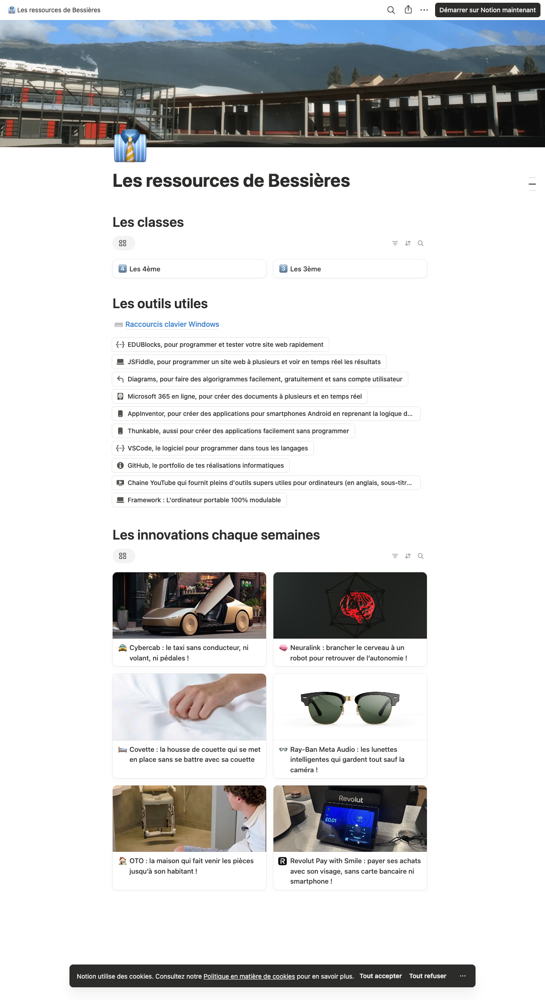

# Analyse de la prise de notes et du rendu des pages Notion

Analyse réalisée le 12 octobre 2026 avec **REA 6.4.0** issu du projet [morluto/rea](https://github.com/morluto/rea). Ce document sépare les observations directes, les comportements décrits par Notion et les choix de conception de Feuillet. Aucun code propriétaire de Notion n'est repris dans le logiciel.

## Preuves obtenues avec REA

Cible observée : [Les ressources de Bessières](https://sandrodepaz.notion.site/Les-ressources-de-Bessi-res-a38ab429987082aba2780183e4ad3957).

Le CLI local `work/rea/node_modules/.bin/rea` a été exécuté pour cette analyse. Un profil Chrome isolé a été utilisé ; aucun compte Notion n'a été connecté et aucune page n'a été modifiée.

| Opération REA réellement exécutée | Identifiant de preuve | Ce qu'elle établit |
|---|---|---|
| `list-browser-targets` | `ev_f300875726f973736e737c3e885c3f48625827bede23660f482febc05c1f5670` | Identité, titre et origine de la page publique |
| `inspect-web-page --include-accessibility-text` | `ev_281b43a4ffbe079b8093b3a3cdcd6b87b03c2a18243e465ee6d2bc1c9c881e57` | Structure DOM et arbre d'accessibilité, titres, liens et boutons |
| `capture-web-screenshot` | `ev_a04ee3531e19874303e404d142db842d74719765a10e1222712b1609c686e823` | Premier rendu du viewport 756 × 469 |
| `capture-browser-scenario` | `ev_4b0bfddbc1d81de05c242874743e688ace27a1af14d0b5670a8118232dfed035` | Navigation publique, attente du contenu et capture finale 1200 × 2200, thème clair |

Le scénario final contient seulement la navigation de départ, l'attente de `.notion-page-content`, puis 2,5 secondes de stabilisation. Il n'a saisi aucun texte ni utilisé de commande de modification. REA a fermé le navigateur temporaire qu'il avait lancé. Chrome observé : 155.0.8059.39.

La capture finale a pour SHA-256 `042ed1ddd579fb0bd255a6bd28a68355e04d9ad2103f6cc10f40394bf53924ef`. L'arbre d'accessibilité a pour SHA-256 `45e6e0fc55441ea74e76a1fccc48b38e2c52fda9cadf90a98d5941cc3de56b73`.



Le relevé compact, sans cookies, identifiants, jetons ni corps réseau, est conservé dans [REA-PREUVES.json](REA-PREUVES.json). Les enveloppes REA complètes et les paramètres du scénario sont conservés dans le dossier de travail `work/rea/`, séparé du logiciel distribué.

## Ce que la page publique démontre

| Élément | Observation directe | Traduction pour Feuillet |
|---|---|---|
| En-tête | Couverture large, emoji partiellement superposé à la couverture, grand titre | Couverture et icône distinctes du contenu du document |
| Lecture | Corps de page centré et espace autour des sections | Largeur de lecture confortable, option de largeur accrue |
| Structure | Trois titres de niveau 2 : classes, outils, innovations | Titres structurants et hiérarchie visuelle |
| Classes | Deux cartes compactes avec emoji et titre, côte à côte | Liens de pages affichables en galerie |
| Sous-page | Lien bleu « Raccourcis clavier Windows » avec pictogramme | Bloc lien vers une page du carnet |
| Ressources | Boutons bordés compacts, icône, libellé ; certains libellés longs sont tronqués | Bloc ressource avec libellé configurable |
| Innovations | Galerie de six cartes visibles, deux colonnes, image et titre | Galerie de ressources avec image et titre |
| Accessibilité | Titres, liens, boutons et lien « Aller au contenu » sont présents dans l'arbre | Commandes natives, noms accessibles, navigation clavier et accès au contenu |

Les boutons de ressources sont exposés comme boutons avec popup, alors que les classes et la sous-page sont exposées comme liens. Cela ne prouve pas la destination exacte de chaque bouton : aucune activation n'a été exécutée pendant ce scénario. Les transformations possibles du contenu ne sont pas déductibles du seul rendu de lecture.

## Prise de notes : comportements décrits officiellement

La documentation officielle [Writing & editing basics](https://www.notion.com/help/writing-and-editing-basics), [son guide](https://www.notion.com/help/guides/writing-and-editing-basics), et [Keyboard shortcuts](https://www.notion.com/en-gb/help/keyboard-shortcuts) ont été consultés le 12 octobre 2026. Les éléments suivants sont **documentés**, mais n'ont pas été testés dans l'éditeur privé de l'utilisateur :

- Le contenu est manipulé en blocs. Le bouton `+` ouvre les types ; la poignée de bloc permet déplacement et actions.
- `/` ouvre une recherche de types et de commandes ; les actions incluent transformation, duplication et suppression.
- La sélection de texte fait apparaître les outils de mise en forme. Les raccourcis usuels de gras, italique et lien sont disponibles.
- `Entrée` et `Maj+Entrée` distinguent nouveau bloc et retour interne. Des préfixes Markdown facilitent titres et listes.
- La page propose des réglages de typographie, taille et largeur ; le mobile dispose d'une barre avec bouton `+`.

Feuillet implémente ses propres contrôles et commandes en français. Les liens vers ces documentations servent de références de comportement ; le logiciel ne dépend pas du service Notion.

## Choix de conception de Feuillet

Ces décisions répondent aux besoins du projet et ne sont pas des observations de Notion :

1. Un seul compte rédacteur ; consultation publique sans compte élève.
2. Pages privées par défaut, avec publication d'une version distincte du brouillon.
3. Même menu d'insertion accessible par `/` et par bouton `+`, y compris sur écran tactile.
4. Bloc texte riche, titres, listes, citation, encadré, tableau, partie repliable, colonnes, média, fichier, lien, galerie et quiz.
5. Déplacement au clavier et boutons haut/bas en complément du glisser-déposer.
6. Enregistrement avec état visible et contrôle de révision pour éviter l'écrasement d'une édition plus récente.
7. Serveur PHP et stockage compatible avec un hébergement mutualisé ; aucune exécution Node.js en production.

## Limites et inconnues explicites

- La page « Enseignement 2026-2027 » nécessite une session authentifiée pour observer son rendu et son éditeur dans le navigateur isolé. Cette analyse REA n'a pas contourné cet accès et ne revendique pas une observation de son édition.
- Le menu `/`, les commandes clavier, le glisser-déposer et l'enregistrement de Notion n'ont pas été testés en édition. Leur référence dans ce rapport vient de la documentation officielle.
- Le scénario n'examine ni contenu privé, ni cookies, ni stockage utilisateur, ni requêtes authentifiées. Aucune extraction de code applicatif ou de code source Notion n'a été utilisée pour le build.
- La capture passive représente une fenêtre limitée. Certaines données de réseau, travailleurs, sources de scripts et événements antérieurs sont volontairement absentes ; leur absence ne prouve pas leur inexistence.
- La galerie et les boutons sont reproduits à partir de leurs caractéristiques observables. La reproduction n'est pas une promesse de parité avec toutes les fonctions de Notion.

## Reproduire le relevé

Les commandes utilisées sont les commandes effectivement disponibles dans REA 6.4.0. Le dossier de travail contient `public-scenario.json` et les captures JSON.

```sh
./node_modules/.bin/rea --version
./node_modules/.bin/rea list-browser-targets http://127.0.0.1:9337 --format json
./node_modules/.bin/rea inspect-web-page http://127.0.0.1:9337 TARGET_ID --include-accessibility-text --format json
./node_modules/.bin/rea capture-web-screenshot http://127.0.0.1:9337 TARGET_ID --format json
./node_modules/.bin/rea capture-browser-scenario public-scenario.json --format json
```

Les trois premières commandes de capture nécessitent un navigateur local exposant son point CDP. Le scénario choisit explicitement l'exécutable Chrome et lance son propre navigateur temporaire. Le navigateur, sa version, les données publiques et l'environnement peuvent évoluer : un nouveau relevé aura de nouveaux identifiants et digests.

## Révision 0.2 — édition et médias

Un nouveau scénario REA a observé la documentation publique de Notion le 12 octobre 2026 : preuve `ev_939df9a2739d1f05e8663140fc0de61f21888376dba18ca7628f8dcd69c68aba`. Il établit l’identité de la page consultée et son contenu documentaire accessible, sans connexion ni modification de l’éditeur Notion. Les paramètres et empreintes sont dans [REA-EDITION-PREUVES.json](REA-EDITION-PREUVES.json). Les preuves de la page publique de Bessières restent utilisées pour la composition des pages et des galeries.

| Besoin | Référence de comportement | Adaptation dans Feuillet |
|---|---|---|
| Sélection de texte | [Écriture et édition](https://www.notion.com/help/writing-and-editing-basics) : menu après sélection, transformation des blocs et couleurs | Menu flottant, types de blocs, couleurs du texte et du fond |
| Images | [Images et médias](https://www.notion.com/help/images-files-and-media) : guides latéraux, largeur et alignement | Poignées de redimensionnement, réglage numérique et alignement |
| Galeries | [Vue galerie](https://www.notion.com/help/galleries) : ordre, aperçu et taille des cartes | Galerie indépendante, pages choisies, ordre et grille configurables |
| Apparence | [Personnalisation](https://www.notion.com/help/customize-and-style-your-content) : polices et pleine largeur | Réglage global avec exceptions par page |

La création d’espaces personnels, la recherche Wikimedia Commons sans clé et la génération PDF locale sont des choix propres à Feuillet. Les comportements d’édition ci-dessus sont documentés par Notion ; ils ne constituent pas une observation de l’éditeur privé avec REA.

## Complément du 13 octobre 2026 : bases, formulaires et images

Les preuves REA du 12 octobre ci-dessus sont réutilisées pour le rendu des galeries publiques. Aucun nouveau test d’édition privée Notion, aucune observation des bases privées et aucune extraction de code propriétaire ne sont revendiqués pour ce complément. Les comportements suivants proviennent de la documentation officielle consultée le 13 octobre 2026.

| Sujet | Référence officielle et comportement documenté | Choix propre à Feuillet |
|---|---|---|
| Propriétés de base | Les [propriétés](https://www.notion.com/help/database-properties) structurent les éléments et permettent recherche, tri et filtrage. | Une base autonome possède des champs configurables et des vues de consultation. |
| Relations | Une [relation](https://www.notion.com/en-gb/help/relations-and-rollups) lie des éléments de bases ; un rollup agrège les propriétés des éléments liés. | Le logiciel implémente les relations prévues par son propre modèle. La parité complète des rollups Notion n’est pas affirmée. |
| Formules | Les [formules](https://www.notion.com/help/formulas) calculent des propriétés à partir des champs existants ; la [syntaxe Notion](https://www.notion.com/help/formula-syntax) dispose de ses propres types, opérateurs et fonctions. | Le moteur de formules Feuillet est un moteur indépendant, limité et validé côté serveur. Le code Notion n’est pas utilisé et la compatibilité complète de langage n’est pas promise. |
| Formulaires | Les [formulaires](https://www.notion.com/help/forms) relient les questions aux propriétés d’une base et peuvent être partagés avec des personnes extérieures. | `/formulaire` ouvre le choix d’un formulaire ; l’accès public, l’acceptation des réponses et la lecture des réponses sont contrôlés séparément côté serveur. |
| Images | Notion documente la [lecture des images](https://www.notion.com/help/images-files-and-media) en plein écran ou dans leur format original. | Une visionneuse animée avec fermeture par Échap, commandes de zoom et déplacement de l’image est développée indépendamment. Le clic droit natif reste disponible. |
| Insertion | La création d’un formulaire par commande `/form` est décrite dans la documentation officielle. | Les commandes françaises `/base` et `/formulaire` insèrent un bloc connecté à un objet persistant du logiciel. |

La page publique Bessières observée par REA contenait des galeries, mais elle ne suffit pas à établir les propriétés, relations, formules ou formulaires de bases privées. Les composants Feuillet sont donc construits à partir des besoins exprimés et des comportements publics documentés, avec validation du parcours propre à Feuillet.
