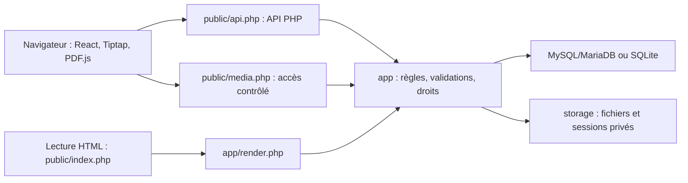

# Architecture de Feuillet

Feuillet est une application web PHP avec une interface React compilée. Le serveur exécute les requêtes PHP à la demande ; aucune application Node.js persistante, file de tâches ou infrastructure VPS n'est nécessaire. Un seul administrateur écrit. Les visiteurs consultent les publications et répondent aux formulaires autorisés.

Cette description correspond au code effectivement présent dans le dépôt. Les résultats de validation restent séparés dans [TESTS.md](TESTS.md).

## Les trois couches

| Partie | Responsabilité |
|---|---|
| `frontend/src/App.tsx` | Navigation, connexion, gestion des pages et coordination de l'interface |
| `Editor.tsx`, `nodes.tsx` | Éditeur Tiptap, blocs standard/personnalisés et leurs outils |
| `Database.tsx` | Vues et formulaires reliés aux bases structurées |
| `Customization.tsx` | Apparence, catégories et paramètres de page/carnet |
| `pdf-export.ts` | Génération de documents PDF dans le navigateur avec jsPDF |
| `public/api.php` | Entrée JSON, en-têtes HTTP, traduction des exceptions en réponses |
| `app/bootstrap.php` | Configuration, PDO, sessions, droits, CSRF, pages et fichiers |
| `app/actions.php` | Distribution des actions générales de l'API |
| `app/features.php` | Espaces, styles, Markdown, Wikimedia et migrations générales |
| `app/customization.php` | Catégories, paramètres du carnet, positions de couverture et publication de l'arborescence |
| `app/databases.php` | Propriétés typées, lignes, relations, agrégations, formulaires et leurs droits |
| `app/formulas.php` | Analyse et calcul borné des formules, sans `eval` |
| `app/render.php` | Production HTML sûre des blocs pour la lecture serveur |
| `app/sharing.php` | Racine de navigation publique, filtrage de branche, liens conservant la racine et signature Feuillet |
| `app/database-views.php` | Tri et filtres de présentation appliqués aux lignes déjà autorisées |
| `app/backup.php` | ZIP portable, validation des imports et remappage des identifiants |

Le backend ne dépend pas de Composer. PDO sélectionne MySQL/MariaDB ou SQLite suivant la configuration ; les migrations adaptées au pilote sont exécutées lors de l'accès à la base.

## Construction et distribution

Les sources React/TypeScript utilisent le cœur libre de Tiptap et ProseMirror. Les menus et blocs enrichis sont ceux de Feuillet ; aucun composant Pro ou service de collaboration Tiptap n'est présent dans le verrouillage npm examiné.

`npm run build` effectue le contrôle TypeScript, prépare PDF.js puis compile l'interface avec Vite. Le résultat est dans `public/assets`. `tools/prepare-pdf.mjs` copie PDF.js, son worker, ses tables de caractères, ses polices de secours, ses modules WebAssembly et ses licences vers `public/vendor/pdfjs`.

La distribution contient ces fichiers préparés. L'hébergement sert du PHP, du HTML et des fichiers statiques : il n'a besoin ni de npm, ni de Vite, ni d'un serveur Node.js. L'export PDF et le lecteur PDF sont des modules distincts de l'éditeur. Les polices sont hébergées localement.

En développement, Vite peut transmettre les routes PHP à `FEUILLET_PHP_URL`, par défaut `http://127.0.0.1:8080`. Le script `npm run dev` écoute sur `127.0.0.1`. Ce serveur reste un outil local ; il ne participe pas au déploiement mutualisé.

## Données et fichiers

| Table | Contenu |
|---|---|
| `pages` | Métadonnées, arborescence, carnet/catégorie, document Tiptap JSON, version et snapshot publié |
| `revisions` | Historique limité des pages avec snapshots de brouillons |
| `files` | ID, nom, MIME, taille, nom physique aléatoire et attribution éventuelle |
| `spaces`, `categories` | Organisation du carnet ; catégories actives ou archivées |
| `app_settings` | Apparence, paramètres généraux et marqueurs de migration |
| `collections` | Bases structurées, noms et visibilité |
| `collection_properties` | Types, options, relations, formules et agrégations |
| `collection_rows` | Valeurs JSON, visibilité, version et provenance des réponses |
| `collection_forms` | Champs autorisés, publication et token public aléatoire |
| `form_uploads` | Appartenance des fichiers au formulaire et à la session anonyme |

Le document Tiptap constitue la source des pages. Le HTML de lecture est généré à partir de ce JSON ; il n'est pas la copie éditable principale. Les fichiers restent sur disque, hors de la base SQL. Leur nom de stockage est aléatoire et n'est pas transmis aux lecteurs.

`storage/` contient les médias, sessions, limitations de fréquence, fichiers temporaires et, en mode SQLite, la base locale. `config.php` contient les paramètres de connexion, le hash du mot de passe administrateur et le secret de l'application. Ces éléments restent hors de Git et de la racine web.

## Enregistrer et publier

Une sauvegarde modifie le brouillon et son numéro de version. La version attendue doit correspondre à celle de la base ; un écran ancien reçoit HTTP 409 et ne remplace pas le contenu récent.

Publier copie le brouillon dans un snapshot, puis publie les sous-pages actuelles de l'arborescence. Par défaut, l’enregistrement d’une page déjà publique synchronise son snapshot dans la même transaction. Si la publication automatique est désactivée dans les réglages, les modifications restent privées jusqu’à une nouvelle publication explicite. Les visiteurs reçoivent les métadonnées et le contenu du snapshot, y compris l'apparence et le cadrage de couverture publiés.

Les titres d'ancêtres privés, la corbeille et les brouillons n'apparaissent pas dans la consultation publique. Les quiz transmis aux visiteurs perdent leurs solutions et explications ; la correction récupère le snapshot serveur après soumission. Ces réponses de quiz ne sont pas conservées.

Chaque URL partagée établit une racine de navigation. `reader_scope_request()` valide la publication de cette racine et parcourt ses enfants publiés avec un index parent/enfants. Les listes publiques, recherches, catégories, carnets, galeries, liens de pages et fils d’Ariane respectent cette branche. Les requêtes `reader-state.php` portent la même racine ; leur jeton ne recense pas les cartes des autres branches. Aucun annuaire général n’est affiché. Le paramètre `root` est validé côté serveur, mais n’est pas un secret ou une autorisation d’accès par groupe. Les bases publiques restent régies par leur propre visibilité. Les fichiers publiés restent accessibles par leurs identifiants selon les règles de médias.

La visibilité d'une base structurée reste distincte : sa consultation anonyme demande une base publique **et** une référence dans une page publiée active. Ses lignes privées et réponses de formulaires sont exclues. Les relations et agrégations publiques ne lisent pas les données de cibles privées.

## Accès aux médias et formulaires

`media.php` contrôle l'accès à chaque ID. Un administrateur peut lire les fichiers ; un visiteur ne peut lire que ceux référencés dans une publication active ou une ligne publique d'une base accessible. Un fichier partagé dans une autre publication reste public. Les plages d'octets et les requêtes HEAD servent la lecture des PDF et médias sans copier tout le fichier en mémoire.

Le lecteur `pdf-viewer.php` applique la même garde. PDF.js charge les octets par `media.php`, avec un worker local. L'export PDF de page est produit côté navigateur ; aucun moteur PDF système ni transcodage serveur n'est utilisé.

Un formulaire public expose ses champs, jamais les lignes collectées. Les envois exigent CSRF, passent par un champ anti-robot et une limitation de fréquence. Les fichiers sont liés à la session et au formulaire jusqu'à la soumission. La réponse est enregistrée comme ligne privée, avec une provenance qui bloque sa publication par `row_save`.

## Frontières et dépendances externes

Les requêtes SQL sont préparées. Le serveur valide les documents, valeurs typées, noms/IDs, couleurs CSS et URLs. Les formules utilisent un interpréteur de données borné. Le lecteur PHP échappe les textes ; l'interface affiche les valeurs par React. Des en-têtes CSP, anti-sniffing et de contrôle d'encadrement complètent ces validations.

La recherche d'images est la connexion externe fonctionnelle intégrée : le proxy PHP interroge Wikimedia Commons et importe des images depuis les hôtes Wikimedia autorisés, sans suivre de redirection. Les attributions sont conservées. Les URL d'images ou médias que l'auteur insère explicitement peuvent aussi être chargées par le navigateur.

Feuillet n'emploie pas React Server Components ni un moteur JavaScript de serveur. La connexion de l'administrateur et les écritures relèvent entièrement de PHP. L'absence de dépendance au VPS ne garantit pas les performances de toutes les offres mutualisées : PHP, SQL, trafic et mémoire ont chacun leurs limites.

## Contraintes actuelles

Le système n'a ni comptes visiteurs, ni édition collaborative, ni synchronisation hors ligne. La recherche couvre le texte des pages et les noms de fichiers, sans OCR ou indexation interne des PDF. L'audio et la vidéo utilisent les formats compatibles avec le navigateur.

Les imports ZIP créent des copies privées et remappent les références ; ils ne constituent pas un remplacement identique de toute l'installation. Les limites de propriétés, lignes, formules, taille des requêtes et archives bornent le travail serveur. Pour une reprise exacte incluant configuration et historique, sauvegarder SQL, `storage/` et `config.php` ensemble.

## Compléments de la livraison 0.4

`app/reader.php` et `public/reader-state.php` calculent un jeton du contenu publié, des cartes autorisées, des bases publiques et du thème. Le lecteur `reading.js` consulte ce jeton toutes les 15 secondes lorsque l’onglet est visible ; le HTML échappé côté PHP est téléchargé uniquement si nécessaire. Aucun service permanent n’est ajouté. Les médias en cours et quiz saisis différèrent le remplacement du contenu, sauf révocation de l’accès.

`auto_publish_page()` synchronise atomiquement le snapshot après l’enregistrement d’une page déjà publique lorsque `notebook.auto_publish` est actif. Une création reste privée. Le mode brouillon reste disponible. Le contrôle de version ne peut pas être contourné par l’actualisation.

`frontend/src/gallery-layout.css` est copié par `tools/prepare-shared-styles.mjs` vers `public/gallery.css`. La structure des cartes et leurs styles sont communs au rendu React et PHP. `ThemeToggle.tsx`, `theme.js` et `theme-toggle.css` conservent une préférence de lecteur locale sans modifier le thème enregistré du carnet.

`IconPicker.tsx` charge paresseusement les catalogues Unicode/CLDR et Lucide. `public/icons.svg` est un sprite fixe de primitives autorisées ; la validation serveur recoupe le nom de dessin avec `icons.json`. La police Noto couleur locale est déclarée une seule fois dans `emoji-font.css`, avec priorité à la police Apple installée. Les fichiers de licence accompagnent la distribution.

L’installation neuve nécessite la clé privée de `storage/installation-key.txt`, lue par FTP. Elle est contrôlée avant connexion SQL et supprimée après écriture atomique de la configuration. Ce fichier n’est pas distribué.

## Compléments 0.4.1

`publish_inherited_children()` parcourt en largeur les branches des parents publics, dans la transaction appelante, avec verrouillage des lignes sur MySQL. Il ne remplace pas les snapshots déjà publiés et ignore les branches supprimées. Le réglage est désactivé par défaut ; les APIs de création, déplacement, restauration, sauvegarde et paramétrage utilisent le même mécanisme. La garde de privatisation exprime l’héritage du parent.

`app/media-usage.php` et `MediaUsage.tsx` fournissent l’inventaire chargé uniquement à la demande par l’administrateur. Ils rapprochent documents, snapshots, galeries, champs fichiers et révisions. La route ne sert jamais aux visiteurs et n’affecte pas `media.php`. `option_colors` appartient au JSON des propriétés : aucune table supplémentaire. La navigation repliée est locale ; son raccourci appartient au réglage du carnet. La normalisation des marques de texte adapte aussi les anciens défauts aux thèmes.

Les couleurs dérivées appartiennent au rendu, jamais aux données stockées. `theme-colors.ts` calcule luminance, contraste, variante HSL et premier plan des boutons. Le build l’embarque dans React et génère `public/theme-colors.js` pour le lecteur. `app/theme-colors.php` fournit le calcul équivalent au premier rendu PHP ; les tests comparent les résultats exacts des deux versions. `--accent-base` conserve la source, tandis que `--accent`, `--green`, `--page-accent`, `--accent-contrast` et `--accent-hover` portent les valeurs dérivées. Le thème personnel recalcule ces variables depuis la source lors de chaque changement et actualisation du lecteur.

## Interface commune — 0.5.0

`Select.tsx` transforme les listes de l’interface React en sélecteurs au clavier avec recherche après six options. Il conserve un select natif pour les valeurs, événements et validations des formulaires. `ContextMenu.tsx` rend les actions contextualisées, leur focus, navigation clavier et état radio éventuel. `FloatingSurface.tsx` utilise l’API Popover avec un positionnement borné par `interface-geometry.ts`, un repli fixe, et une adaptation au viewport visuel. Les surfaces restent dans le DOM de leur dialogue et thème : Les menus de propriétés affichés dans un bloc Tiptap sont portés dans le panneau de page, hors du DOM éditable, pour préserver leur focus. Ce panneau porte le même thème de page.

Les commandes de page réutilisent `openPage`, la sauvegarde et les actions existantes, avec vérification de l’ID ouvert avant toute mutation. Les commandes de bloc passent par les transactions Tiptap/ProseMirror ; les actions de propriété gardent les callbacks du gestionnaire de bases. Les menus n’ajoutent aucun endpoint ni permission serveur. Édition, fermeture des formulaires sales et conflits de versions gardent leurs garde-fous existants.

`interface.css` porte les finitions partagées ; `tools/prepare-shared-styles.mjs` le copie vers `public/interface.css`, chargé après les styles de lecture. Il ne modifie pas les ratios ni dimensions des galeries. Le sélecteur et les menus d’administration ne sont pas injectés dans le lecteur public HTML. Les formulaires publics React utilisent le sélecteur commun. Le lecteur conserve des contrôles de thème légers en JavaScript autonome.

Les styles historiques restent en place. Les jetons et composants communs s’ajoutent dans le système CSS existant ; une extraction progressive des règles historiques peut réduire les doublons lors d’une évolution future. [Charte graphique](CHARTE-GRAPHIQUE.md).

## Carnets — 0.5.1

Les carnets utilisent la table historique `spaces` et le champ `pages.space_id`. La migration `notebooks_migrated` se fait une seule fois dans une transaction, conserve IDs de pages et catégories et leurs versions, et remplit les snapshots publiés avec le même carnet. L’identifiant du carnet migré est stable pour éviter les doublons lors de requêtes concurrentes. La création d’une page sans carnet choisit un carnet réel ; la sous-page hérite du carnet parent. Supprimer un carnet déplace pages, catégories et snapshots dans un carnet conservé, sans supprimer le contenu. La suppression du dernier carnet crée une destination. Les anciens `homepage_id` restent inactifs dans les installations historiques et sont ignorés à l’import ; aucun écran d’accueil configurable n’existe plus.

`PoweredBy.tsx` et `render_powered_by()` produisent la signature et le même lien GitHub. Leurs styles appartiennent à la feuille commune `interface.css`, à l’exception du lecteur PDF autonome qui utilise sa feuille locale.

## Ajustements 0.5.2

Le choix du carnet et les filtres restent pilotés par activeSpace/kind ; leurs boutons portent aria-pressed. IconPicker accepte emojiOnly pour réutiliser le catalogue du carnet sans afficher les outils de fichiers non disponibles à cet endroit. La sélection reste locale au formulaire jusqu’au POST save_space. ColorControl partage le rendu des champs natifs Fond/Texte/Accent. Aucun endpoint ou schéma supplémentaire.

## Largeur de navigation — 0.5.4

`SidebarResizer.tsx` est un composant isolé, monté uniquement dans la navigation d’administration visible sur ordinateur. Il ajuste la variable CSS `--sidebar` de `.app-shell` : barre et marge de la zone principale se recalculent ensemble. Le composant possède son état de glissement pour ne pas faire rerendre App/Tiptap à chaque mouvement. Pointer capture, annulation, perte de capture, blur et démontage nettoient les classes temporaires. Le démontage enlève la variable propre au desktop pour conserver la largeur mobile.

`sidebar-width.ts` borne la largeur et valide le stockage ; `feuillet.sidebar-width` dans localStorage conserve la préférence. L’événement storage synchronise les onglets. Aucun endpoint ou champ SQL. Un ResizeObserver de la zone principale recalcule la hauteur du titre uniquement si sa largeur a changé, via requestAnimationFrame, et est nettoyé au changement de page.

## Rédaction contextuelle — 0.6

`Editor.tsx` remplace la barre permanente par l’historique et un bouton d’insertion. Un portail positionne les contrôles au-dessus du bloc sélectionné ; une sélection vide, un nœud média ou un champ extérieur les masque. Focus, transactions, défilement et redimensionnement recalculent l’ancrage par animation frame. `App.tsx` route Entrée ou Tab du textarea de titre vers `editor.commands.focus("start")`.

`ToggleHeading.tsx` définit `toggleHeading`, de contenu `heading block+`. Une NodeView React fournit la flèche et un seul domaine éditable ; le wrapper interne Tiptap est explicitement pris en compte par les styles de repli. La première heading garde ses marques et son niveau ; une transformation en titre ordinaire retire le conteneur sans supprimer les blocs suivants. L’état ouvert est local à la NodeView. Tab/Entrée en fin de titre passent au premier contenu.

`normalize_doc()` vérifie le premier titre, son niveau 1/2/3 et la présence d’un contenu bloc. `render_document()` produit un `
` avec le vrai titre dans `
`. Le lecteur reste en PHP, sans React ni API externe. `pdf-export.ts` parcourt tous les enfants. Le Markdown lisible déplie le contenu ; les métadonnées d’export existantes assurent le retour exact du document. Les styles partagés sont copiés à la compilation. Aucun changement SQL.

## Blocs, accueil et import — 0.7

`block-moving.ts` calcule les blocs manipulables, les positions de destination et une transaction atomique de déplacement. Il refuse les cycles et les insertions incompatibles avec le schéma, et conserve un paragraphe vide si nécessaire. `BlockMover.tsx` fournit la poignée, capture le pointeur au-delà de 5 px, dessine le repère de dépôt et assure annulation/autodéfilement. Le titre initial d’un `toggleHeading` n’est pas un bloc autonome ; il déplace sa section. Les menus ciblent désormais le bloc imbriqué au lieu de son seul ancêtre racine. `feuillet:unfold` ouvre une section après un dépôt intérieur.

`AdminHome.tsx` trie les métadonnées existantes par `updated_at`, sans nouvel historique de visites ni télémétrie. La route admin `?dashboard=1` est accessible par le logo ou le nom et conserve la sauvegarde avant navigation. Aucun accueil public ni inventaire anonyme de pages n’est réintroduit. Le bouton de navigation est dans `.workspace-heading`.

`app/document-import.php` est chargé par l’action admin/CSRF `import_document`. TXT accepte UTF-8 et UTF-16 avec BOM. Markdown réutilise le parseur et les métadonnées existants. RTF est lu par un parseur borné (2 Mo, 300000 étapes, profondeur 64), sans exécution, objet, HTML ou accès réseau. La page créée est une racine privée du carnet actif. `import_markdown` reste disponible pour compatibilité.

`MapBlock.tsx` et `render_document()` fournissent le même bloc de lieu. `map_embed_url()` et son équivalent client limitent les URLs facultatives à HTTPS, aux domaines Google précis et au chemin `/maps/embed` avec `pb` ; les URLs d’API avec clé sont exclues. Le serveur n’interroge pas Google : l’iframe publique et le lien sont chargés par le navigateur. CSP ajoute uniquement les origines Google nécessaires. Les exports texte conservent l’adresse/lien.

`FeuilletLogo.tsx`, `public/feuillet-logo.svg`, le PNG et le favicon partagent un dessin original. Le rendu PHP utilise ce SVG statique contrôlé par le dépôt, avec accent du thème ; aucun SVG utilisateur n’est interpolé. Le nom d’icône intégré est `feuillet`, avec alias `f.`. Aucun changement SQL ni dépendance de production.

## Installation et mises à jour intégrées — 0.8

Utiliser l’archive installable de la release et conserver `update-manifest.json`. L’installateur guidé demande la clé privée lue par FTP dans `storage/installation-key.txt`, puis les réglages du carnet et la base dédiée. cURL, ZIP, tokenizer et l’écriture du code sont nécessaires aux mises à jour depuis GitHub. Le dépôt encore privé nécessite un jeton GitHub limité à la lecture du contenu de ce dépôt ; aucun changement de visibilité n’est effectué.

Les notifications et choix sont dans `storage/updates/settings.json`. Le déploiement prépare une extraction vérifiée, sauvegarde le code et la base, conserve configuration/médias, pose `storage/update-journal.json` et remplace les fichiers sous verrou exclusif. `public/update-guard.php` précède le bootstrap sur les points d’entrée ordinaires. `public/update-health.php` valide le nouveau processus ; `public/recover.php` et la copie privée du moteur de récupération peuvent rétablir la version précédente. Les sauvegardes ne sont pas servies publiquement et restent téléchargeables par l’admin après succès ou retour arrière.

La restauration dépend des droits, de l’espace disque et de SQL. Les médias ne sont pas recopiés. Voir [les étapes et la procédure FTP](MISES-A-JOUR.md) avant de supprimer un dossier de sauvegarde. Aucun cron, shell système ou service permanent n’est requis. L’installation OVH réelle reste à vérifier sur l’offre de l’utilisateur.

Le verrou de contrôle des updates (`storage/updates/control.lock`) est distinct du verrou de déploiement. Vérification GitHub, téléchargement et extraction ne bloquent pas la lecture ni les sauvegardes des pages. La session PHP est fermée après authentification/CSRF pour ces opérations. Seule la sauvegarde cohérente suivie d’activation prend le verrou de déploiement ; les endpoints autonomes de santé/récupération sont les seules entrées pendant cette maintenance.

## Navigation et vocabulaire — 0.8.1

Le tableau de bord et la sélection du carnet sont indépendants. `openDashboard` sauvegarde la page puis remplace le panneau principal sans recharger ni vider les données de navigation et sans fermer le tiroir mobile. Le bouton du fil d’Ariane vérifie l’existence d’une page avant de sélectionner son carnet. Les catégories initiales utilisent Notes/Articles ; les clés `legacy_kind` et `kind=class` sont conservées pour lire les anciennes bases et sauvegardes. La normalisation de l’ancien sous-titre par défaut s’effectue à la lecture des réglages et préserve tout texte personnalisé.

## Couleur des titres — 0.8.2

La variable --heading-ink est définie par themeStyle côté React et appearance_css côté PHP ; theme.js l’actualise lors d’un changement de thème personnel du lecteur. Le style partagé interface.css couvre les titres et leurs marques de texte imbriquées, ainsi que les champs de titre et les titres de cartes, sans modifier les attributs enregistrés. Les styles historiques de titres de l’éditeur utilisent également cette variable.
