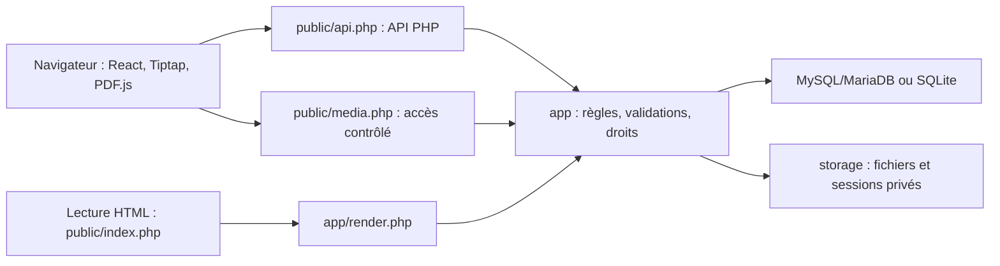

# Architecture de Feuillet

Feuillet est une application web PHP avec une interface React compilée. Le serveur exécute les requêtes PHP à la demande ; aucune application Node.js persistante, file de tâches ou infrastructure VPS n'est nécessaire. Un seul administrateur écrit. Les visiteurs consultent les publications et répondent aux formulaires autorisés.

Cette description correspond au code effectivement présent dans le dépôt. Les résultats de validation restent séparés dans [TESTS.md](TESTS.md).

## Les trois couches

| Partie | Responsabilité |
|---|---|
| `frontend/src/App.tsx` | Navigation, connexion, gestion des pages et coordination de l'interface |
| `Editor.tsx`, `nodes.tsx` | Éditeur Tiptap, blocs standard/personnalisés et leurs outils |
| `Database.tsx` | Vues et formulaires reliés aux bases structurées |
| `Customization.tsx` | Apparence, catégories et paramètres de page/carnet |
| `pdf-export.ts` | Génération de documents PDF dans le navigateur avec jsPDF |
| `public/api.php` | Entrée JSON, en-têtes HTTP, traduction des exceptions en réponses |
| `app/bootstrap.php` | Configuration, PDO, sessions, droits, CSRF, pages et fichiers |
| `app/actions.php` | Distribution des actions générales de l'API |
| `app/features.php` | Espaces, styles, Markdown, Wikimedia et migrations générales |
| `app/customization.php` | Catégories, paramètres du carnet, positions de couverture et publication de l'arborescence |
| `app/databases.php` | Propriétés typées, lignes, relations, agrégations, formulaires et leurs droits |
| `app/formulas.php` | Analyse et calcul borné des formules, sans `eval` |
| `app/render.php` | Production HTML sûre des blocs pour la lecture serveur |
| `app/homepage.php` | Choix de la page d’accueil ; elle conserve les règles de brouillon et publication des pages ordinaires |
| `app/database-views.php` | Tri et filtres de présentation appliqués aux lignes déjà autorisées |
| `app/backup.php` | ZIP portable, validation des imports et remappage des identifiants |

Le backend ne dépend pas de Composer. PDO sélectionne MySQL/MariaDB ou SQLite suivant la configuration ; les migrations adaptées au pilote sont exécutées lors de l'accès à la base.

## Construction et distribution

Les sources React/TypeScript utilisent le cœur libre de Tiptap et ProseMirror. Les menus et blocs pédagogiques sont ceux de Feuillet ; aucun composant Pro ou service de collaboration Tiptap n'est présent dans le verrouillage npm examiné.

`npm run build` effectue le contrôle TypeScript, prépare PDF.js puis compile l'interface avec Vite. Le résultat est dans `public/assets`. `tools/prepare-pdf.mjs` copie PDF.js, son worker, ses tables de caractères, ses polices de secours, ses modules WebAssembly et ses licences vers `public/vendor/pdfjs`.

La distribution contient ces fichiers préparés. L'hébergement sert du PHP, du HTML et des fichiers statiques : il n'a besoin ni de npm, ni de Vite, ni d'un serveur Node.js. L'export PDF et le lecteur PDF sont des modules distincts de l'éditeur. Les polices sont hébergées localement.

En développement, Vite peut transmettre les routes PHP à `FEUILLET_PHP_URL`, par défaut `http://127.0.0.1:8080`. Le script `npm run dev` écoute sur `127.0.0.1`. Ce serveur reste un outil local ; il ne participe pas au déploiement mutualisé.

## Données et fichiers

| Table | Contenu |
|---|---|
| `pages` | Métadonnées, arborescence, espace/catégorie, document Tiptap JSON, version et snapshot publié |
| `revisions` | Historique limité des pages avec snapshots de brouillons |
| `files` | ID, nom, MIME, taille, nom physique aléatoire et attribution éventuelle |
| `spaces`, `categories` | Organisation du carnet ; catégories actives ou archivées |
| `app_settings` | Apparence, paramètres du carnet, page d’accueil et marqueurs de migration |
| `collections` | Bases structurées, noms et visibilité |
| `collection_properties` | Types, options, relations, formules et agrégations |
| `collection_rows` | Valeurs JSON, visibilité, version et provenance des réponses |
| `collection_forms` | Champs autorisés, publication et token public aléatoire |
| `form_uploads` | Appartenance des fichiers au formulaire et à la session anonyme |

Le document Tiptap constitue la source des pages. Le HTML de lecture est généré à partir de ce JSON ; il n'est pas la copie éditable principale. Les fichiers restent sur disque, hors de la base SQL. Leur nom de stockage est aléatoire et n'est pas transmis aux lecteurs.

`storage/` contient les médias, sessions, limitations de fréquence, fichiers temporaires et, en mode SQLite, la base locale. `config.php` contient les paramètres de connexion, le hash du mot de passe administrateur et le secret de l'application. Ces éléments restent hors de Git et de la racine web.

## Enregistrer et publier

Une sauvegarde modifie le brouillon et son numéro de version. La version attendue doit correspondre à celle de la base ; un écran ancien reçoit HTTP 409 et ne remplace pas le contenu récent.

Publier copie le brouillon dans un snapshot, puis publie les sous-pages actuelles de l'arborescence. Par défaut, l’enregistrement d’une page déjà publique synchronise son snapshot dans la même transaction. Si la publication automatique est désactivée dans les réglages, les modifications restent privées jusqu’à une nouvelle publication explicite. Les visiteurs reçoivent les métadonnées et le contenu du snapshot, y compris l'apparence et le cadrage de couverture publiés.

Les titres d'ancêtres privés, la corbeille et les brouillons n'apparaissent pas dans la consultation publique. Les quiz transmis aux visiteurs perdent leurs solutions et explications ; la correction récupère le snapshot serveur après soumission. Ces réponses de quiz ne sont pas conservées.

La page d’accueil est une page ordinaire choisie dans les réglages ; sa désignation n’équivaut pas à sa publication.

La visibilité d'une base structurée reste distincte : sa consultation anonyme demande une base publique **et** une référence dans une page publiée active. Ses lignes privées et réponses de formulaires sont exclues. Les relations et agrégations publiques ne lisent pas les données de cibles privées.

## Accès aux médias et formulaires

`media.php` contrôle l'accès à chaque ID. Un administrateur peut lire les fichiers ; un visiteur ne peut lire que ceux référencés dans une publication active ou une ligne publique d'une base accessible. Un fichier partagé dans une autre publication reste public. Les plages d'octets et les requêtes HEAD servent la lecture des PDF et médias sans copier tout le fichier en mémoire.

Le lecteur `pdf-viewer.php` applique la même garde. PDF.js charge les octets par `media.php`, avec un worker local. L'export PDF de page est produit côté navigateur ; aucun moteur PDF système ni transcodage serveur n'est utilisé.

Un formulaire public expose ses champs, jamais les lignes collectées. Les envois exigent CSRF, passent par un champ anti-robot et une limitation de fréquence. Les fichiers sont liés à la session et au formulaire jusqu'à la soumission. La réponse est enregistrée comme ligne privée, avec une provenance qui bloque sa publication par `row_save`.

## Frontières et dépendances externes

Les requêtes SQL sont préparées. Le serveur valide les documents, valeurs typées, noms/IDs, couleurs CSS et URLs. Les formules utilisent un interpréteur de données borné. Le lecteur PHP échappe les textes ; l'interface affiche les valeurs par React. Des en-têtes CSP, anti-sniffing et de contrôle d'encadrement complètent ces validations.

La recherche d'images est la connexion externe fonctionnelle intégrée : le proxy PHP interroge Wikimedia Commons et importe des images depuis les hôtes Wikimedia autorisés, sans suivre de redirection. Les attributions sont conservées. Les URL d'images ou médias que l'auteur insère explicitement peuvent aussi être chargées par le navigateur.

Feuillet n'emploie pas React Server Components ni un moteur JavaScript de serveur. La connexion de l'administrateur et les écritures relèvent entièrement de PHP. L'absence de dépendance au VPS ne garantit pas les performances de toutes les offres mutualisées : PHP, SQL, trafic et mémoire ont chacun leurs limites.

## Contraintes actuelles

Le système n'a ni comptes élèves, ni édition collaborative, ni synchronisation hors ligne. La recherche couvre le texte des pages et les noms de fichiers, sans OCR ou indexation interne des PDF. L'audio et la vidéo utilisent les formats compatibles avec le navigateur.

Les imports ZIP créent des copies privées et remappent les références ; ils ne constituent pas un remplacement identique de toute l'installation. Les limites de propriétés, lignes, formules, taille des requêtes et archives bornent le travail serveur. Pour une reprise exacte incluant configuration et historique, sauvegarder SQL, `storage/` et `config.php` ensemble.

## Compléments de la livraison 0.4

`app/reader.php` et `public/reader-state.php` calculent un jeton du contenu publié, des cartes autorisées, des bases publiques et du thème. Le lecteur `reading.js` consulte ce jeton toutes les 15 secondes lorsque l’onglet est visible ; le HTML échappé côté PHP est téléchargé uniquement si nécessaire. Aucun service permanent n’est ajouté. Les médias en cours et quiz saisis différèrent le remplacement du contenu, sauf révocation de l’accès.

`auto_publish_page()` synchronise atomiquement le snapshot après l’enregistrement d’une page déjà publique lorsque `notebook.auto_publish` est actif. Une création reste privée. Le mode brouillon reste disponible. Le contrôle de version ne peut pas être contourné par l’actualisation.

`frontend/src/gallery-layout.css` est copié par `tools/prepare-shared-styles.mjs` vers `public/gallery.css`. La structure des cartes et leurs styles sont communs au rendu React et PHP. `ThemeToggle.tsx`, `theme.js` et `theme-toggle.css` conservent une préférence de lecteur locale sans modifier le thème enregistré du carnet.

`IconPicker.tsx` charge paresseusement les catalogues Unicode/CLDR et Lucide. `public/icons.svg` est un sprite fixe de primitives autorisées ; la validation serveur recoupe le nom de dessin avec `icons.json`. La police Noto couleur locale est déclarée une seule fois dans `emoji-font.css`, avec priorité à la police Apple installée. Les fichiers de licence accompagnent la distribution.

L’installation neuve nécessite la clé privée de `storage/installation-key.txt`, lue par FTP. Elle est contrôlée avant connexion SQL et supprimée après écriture atomique de la configuration. Ce fichier n’est pas distribué.
