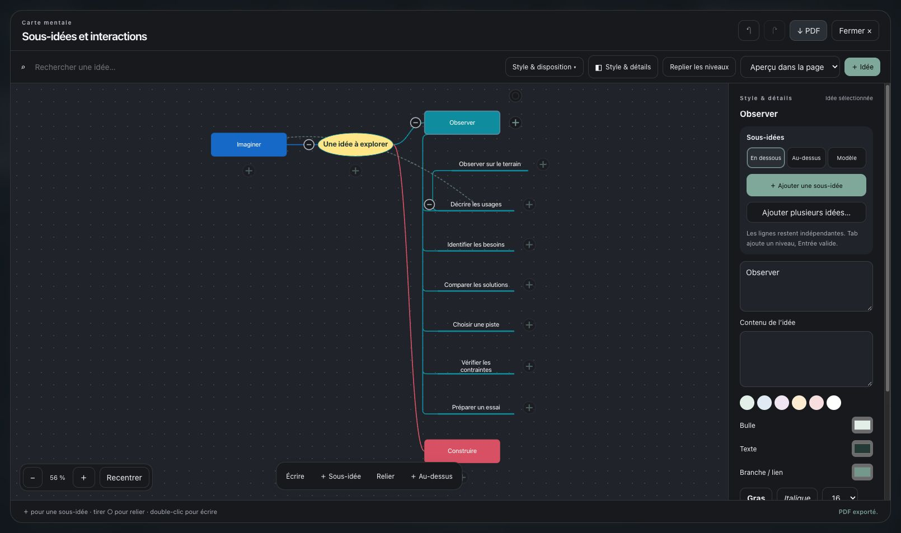

# Cartes mentales — historique des essais locaux

La version finale 0.35.0 reprend ces essais après autorisation de publication. Les mentions de préversion et d’absence de publication ci-dessous décrivent les étapes de travail antérieures. Voir [les nouveautés 0.35](NOUVEAUTES-0.35.md). Publier une release ne met pas automatiquement à jour une installation de production.

## Essayer

Dans une page, saisir `/carte mentale` puis choisir **Carte mentale**. Le menu d’ajout de blocs contient la même commande. La carte est enregistrée dans le contenu de la page et suit son autosauvegarde, son historique, sa publication, ses copies indépendantes et sa sauvegarde JSON. Les visiteurs peuvent explorer uniquement la version publiée.

Trois affichages : bouton d’ouverture, aperçu dans le document, ou carte entière dans une zone haute de la page. Le bouton **Agrandir** ouvre un espace plein écran ; **Fermer** ou Échap revient au document. La carte publique possède sa propre recherche, ses résultats cliquables, le déplacement du fond, les boutons de zoom et le recentrage. Aucun droit d’édition n’est donné au visiteur.

Six mises en page : rayonnante, arborescence, organigramme, parcours, équilibrée et étoile. Changer la mise en page réorganise les positions sans effacer les idées. Le type Parcours dispose les idées horizontalement sans réécrire leurs relations. Chaque présentation mémorise ses positions, y compris après sauvegarde. Double-cliquer une bulle permet de saisir directement son texte. Le petit « + » près de chaque bulle ajoute une sous-idée et place le clavier dans son titre. Tirer la poignée ronde sur une bulle rattache cette dernière comme sous-idée ; la déposer sur le fond crée une idée au point de dépôt. Le mode Lien libre crée une relation transversale. Échap annule le geste.

Sélectionner une bulle affiche une barre contextuelle et actualise les réglages dans le panneau ouvert à droite. Le bouton « Style & détails » sert uniquement à masquer ou réafficher ce panneau : texte, couleurs de bulle/texte/branche, gras, italique, taille, lien web et parent. **＋ Idée** ajoute une branche depuis la sélection. Les bulles se déplacent par glisser. Les liens transversaux relient deux idées ; ils ont une couleur distincte et peuvent être retirés. Supprimer une idée rattache ses enfants à son parent.

**PDF** exporte l’ensemble de la carte, y compris hors du cadrage courant, sur une page vectorielle ajustée au contenu. L’export est également accessible aux visiteurs. Les caractères français ont été vérifiés ; les pictogrammes/alphabets non couverts par les polices PDF standards restent un point de cette préversion à enrichir. L’export Markdown restitue les idées sous forme de liste ; la sauvegarde Feuillet conserve toute la structure.

## Projection des bases

Les colonnes de fichiers apparaissent par défaut avec la colonne de titre. Chaque pièce jointe possède son lien de téléchargement ; les colonnes peuvent toujours être choisies dans **Colonnes**. Ces liens sont réservés à la projection administrateur et passent par le contrôle d’accès de `media.php`.

Dans chaque en-tête de colonne textuelle, **Copier** met les valeurs affichées dans le presse-papiers, une valeur par ligne, directement collables dans une roue de tirage externe. Les retours à la ligne internes sont remplacés par des espaces, les valeurs vides ignorées, les doublons conservés. La projection affiche au plus les 200 dernières lignes : cette limite est également celle de la copie. Le regroupement visuel ne change pas le contenu de la copie. Aucun nom n’est transmis à une roue externe par Feuillet.

## Architecture et limites de test

- Bloc Tiptap atomique `mindMap`, schéma normalisé par `app/mind-map.php` : 1 à 300 bulles, 600 liens transversaux, couleurs hexadécimales, références contrôlées et cycles de parents refusés.
- Libellés traités comme texte, jamais comme HTML ; liens limités à HTTP/HTTPS. Aucun service externe requis. Pas de migration SQL.
- Rendu SVG React commun à l’éditeur et au lecteur ; chargement différé du composant si une carte est présente. Le lecteur monte et démonte ses cartes après les navigations internes.
- Zoom de 3 % à 1 200 %, navigation libre sur la surface ; coordonnées bornées pour protéger la sauvegarde. Ce sont des limites explicites, pas une promesse d’une quantité infinie de données.
- PDF local avec la dépendance jsPDF déjà présente ; fonds de bulles et texte vectoriels. Les courbes des branches web deviennent des traits dans le PDF, et les formes organiques y sont approchées par des ellipses. Toutes les idées sont exportées, même lorsqu’elles sont repliées à l’écran.
- Les téléchargements et métadonnées de pièces jointes de projection proviennent seulement des colonnes sélectionnées ; ni jetons de formulaires ni colonnes masquées dans la réponse. Endpoint réservé à l’administration.

## Vérifications

Compilation TypeScript/Vite ; tests HTTP des cartes (sauvegarde, publication, accès visiteur, refus des cycles/références invalides/URL actives), formulaires/projection et sécurité. Essais navigateur : modification, ajout de bulle, recherche publique, plein écran et export PDF ; téléchargement d’une pièce jointe depuis la projection et copie de colonne vérifiée par collage dans un champ du navigateur. Commande `/carte mentale` testée dans le menu slash, insertion d’un second bloc et présentation par bouton vérifiées. PDF téléchargé, contrôlé et rendu en image : une page, aucune coupure sur l’exemple, pas de JavaScript dans le PDF.

## Révision UX de la préversion

Le bouton de changement de modèle utilise désormais `switchLayout`, séparé du calcul des dispositions : aucune réécriture des parents. Les positions de chaque modèle sont enregistrées dans `views` et validées au serveur. Les anciennes cartes modifiées par le premier mode Parcours conservent leur structure enregistrée ; la nouvelle version ne devine pas leurs liens antérieurs.

Le cadrage ne se réinitialise plus à chaque sélection ou ajout. Les mouvements de réorganisation sont interpolés ensemble pour les bulles, les branches et la caméra, avec une transition interrompable. Les gestes de déplacement et la saisie répondent immédiatement. Les contrôles +/liaison gardent une zone de 44 pixels quelle que soit l’échelle de la carte. Les utilisateurs ayant demandé moins de mouvements obtiennent les mêmes états sans les transitions.

Les commandes Annuler/Rétablir de la carte sont disponibles pendant l’édition plein écran. Leur historique local est conservé tant que le bloc est monté ; l’historique de page complète celui-ci. La création garde les limites de 300 idées / 600 relations transversales. Les relations déjà enregistrées ne sont jamais effacées par un changement de modèle.

## Templates inspirés des références

La préversion ajoute les styles **Branches colorées**, **Bulles organiques** et **Carte classique**, avec miniatures dans le panneau **Style & disposition**. Le style Cartes est conservé. Les dispositions Équilibrée et Étoile complètent les quatre dispositions initiales. Les choix de style mémorisent leur disposition pour permettre un retour à l’état précédent.

Le + est disponible sur chaque bulle, y compris les idées secondaires ; il passe sur le côté des lignes empilées pour ne pas recouvrir la ligne suivante. Le contenu d’une bulle organique se modifie par double-clic dans son corps ou dans Style & détails. Les contrôles de dépliage sont disponibles aux lecteurs ; la recherche ouvre les branches nécessaires pour montrer un résultat. Le repliage est une préférence de vue locale au composant, sans suppression ni modification des relations. Les cartes organiques commencent au niveau principal pour conserver une vue lisible.

Analyse fonctionnelle et revue des skills : [CARTES-MENTALES-UX.md](CARTES-MENTALES-UX.md). Les anciennes captures restent des étapes de développement et ne représentent pas toutes le dernier rendu. Aucune publication GitHub pendant ces essais.

### Validation de la révision `0.35.0-dev.7`

- Compilation TypeScript/Vite réussie ; suite frontend complète réussie, y compris les tests des modèles et sous-idées. Le contexte simulé du test de thème public a été complété avec `getComputedStyle`, déjà utilisé par le script réel.
- Tests HTTP des cartes : 4 réussis ; sécurité : 14 réussis.
- Navigateur intégré : trois nouveaux styles, création par + sur chacun, chaîne de quatre niveaux, contenu séparé d’une bulle organique, recherche d’un descendant replié, changements de styles, Annuler/Rétablir et sauvegarde après rechargement. La carte fictive contient 17 idées ; la carte de l’utilisateur n’a pas servi de fixture pour cette validation finale.
- Lecteur sans connexion sur une origine locale séparée : recherche et plein écran fonctionnels, aucun bouton d’édition, contraste du style souligné vérifié en thème clair. Thème sombre vérifié dans l’éditeur.
- PDF classique et organique téléchargés depuis l’interface, puis rendus en images pour contrôle. Les idées repliées et le contenu des bulles figurent dans l’export.
- Aucun message d’erreur console observé sur la page de validation finale. Ces essais ne remplacent pas les limites matérielles détaillées dans l’analyse UX.

Captures de cette révision : [sélecteur des modèles](assets/cartes-mentales-modeles.png), [branches](assets/cartes-mentales-branches.png), [organique](assets/cartes-mentales-organiques.png), [classique](assets/cartes-mentales-classique.png).

## Révision `0.35.0-dev.15` : panneau, sous-idées et interactions

- **Style & détails** est ouvert à droite par défaut. Un seul bouton dédié le masque ; une nouvelle sélection, le double-clic ou l’annulation d’une idée ne le ferment pas.
- Pour chaque idée, choisir **En dessous** ou **Au-dessus** pour empiler ses sous-idées sous forme de lignes. **Modèle** rétablit la disposition du template pour ce groupe. Les sous-niveaux sont conservés, et les branches voisines qui se chevaucheraient sont déplacées avec leurs descendants.
- **Ajouter plusieurs idées…** crée une idée par ligne de texte, en un groupe annulable. Après l’ajout par lot ou le changement de côté, le groupe modifié est recadré. La limite reste 300 idées par carte.
- Le clic droit propose le menu de la carte, y compris dans l’éditeur sans plein écran. **Maj+F10**, les flèches et Échap permettent de l’utiliser au clavier. Les champs de texte gardent leur menu natif.
- La saisie au double-clic utilise le fond et le texte du thème courant, une sélection contrastée et une surface minimale affichée de 220 × 100 pixels. Elle reste lisible sur le canevas sombre.
- Les dépliages/replis et créations animent ensemble les idées et leurs branches ; une inversion rapide reprend la progression en cours. Les liens libres apparaissent en fondu, les rattachements tracent la nouvelle branche. Pas d’animation à chaque caractère saisi.

### Validation de cette révision

Compilation TypeScript/Vite et suite frontend complète réussies. 5 tests HTTP des cartes et 14 tests de sécurité réussis. `git diff --check` sans erreur. Les tests de modèle couvrent les deux côtés, les sous-groupes, la conservation des textes/parents, les collisions, le retour au template et le plafond de 300 idées.

Essais navigateur sur une page fictive distincte : création par lot et annulation/rétablissement, ajout au-dessus d’un sous-niveau, double-clic lisible, panneau masqué/réaffiché, panneau conservé après annulation d’une idée sélectionnée, menu spécifique en plein écran et dans la page, navigation clavier dans le menu, lien libre et annulation/rétablissement, replis/réouvertures rapides. Les styles d’opacité et de transformation intermédiaires ont été observés dans le DOM. Aucune erreur console observée lors du dernier contrôle.

La page fictive sauvegardée possède 11 idées, dont 7 lignes et deux groupes avec un côté spécifique. Le lecteur public local en thème clair permet toujours de rechercher une sous-idée repliée et d’ouvrir son chemin, sans inspecteur ni commandes d’édition. Le PDF final a été téléchargé depuis l’interface et rendu en image ; les lignes et leur sous-niveau au-dessus sont reliés. La source de la carte de l’utilisateur n’a pas été modifiée pour ces essais.

Les limites de mesure matérielle, de contrôle à 10 % de vitesse et de confort tactile physique décrites dans l’analyse UX restent explicites. Cette validation ne promet pas une fréquence d’images sur tous les appareils.

Préversion locale uniquement ; aucun tag, commit ou envoi GitHub dans cette révision.

## Révision de navigation et d’import `0.35.0-dev.20`

La révision suivante remplace la logique de réutilisation des positions entre styles, ajoute la redistribution globale, les idées indépendantes, le zoom au pointeur, les conversions par clic droit, les imports structurés MD/TEX et les options depuis la poignée du bloc. Le partage crée une **page dédiée indépendante**, privée avant publication explicite, avec adresse personnalisable.

Le fonctionnement, les formats pris en charge, les limites et les vérifications sont décrits dans [CARTES-MENTALES-IMPORT.md](CARTES-MENTALES-IMPORT.md). Cette révision reste locale ; aucun commit, tag ou envoi GitHub.

## Révision `0.35.0-dev.26` : contours, centre et contenus

- **Contour de l’idée** : suivre le modèle, soulignage uniquement, ou contour et fond. Le rectangle de focus demeure visible quand une idée soulignée est sélectionnée.
- **Redistribuer** demande désormais quelle idée placer au centre. Le calcul utilise temporairement cette racine pour la disposition, puis conserve les vrais parents, les contenus et les liens. Il est annulable.
- Huit couleurs vives complètent les six couleurs douces. Le texte s’adapte au fond ; sur une idée soulignée, la couleur prédéfinie colore le trait.
- **Contenus de l’idée** : bibliothèque, import de fichier, lien web, vidéo en ligne et formulaire Feuillet. Images, vidéos et audio locaux se lisent dans la section en grand ; les documents ont un lien d’ouverture. Les vidéos en ligne utilisent le résolveur de fournisseurs existant. Les formulaires de ce site s’affichent dans la section, sans transmettre de réponse automatiquement. 30 contenus au maximum par idée.
- Les pièces jointes suivent l’accès de la carte publiée via `files_in` et `media.php`. Les URL actives sont rejetées ; le serveur recalcule les sources vidéo autorisées et le MIME des fichiers. Aucun code HTML arbitraire n’est ajouté.

Validation : compilation, suite frontend, sept tests HTTP des cartes et quatorze tests de sécurité. Tests navigateur sur une carte fictive séparée de l’onglet en cours d’édition : sous-idée soulignée, palette vive, redistribution centrée, image SVG depuis la bibliothèque, lien, intégration YouTube et formulaire local. Le formulaire a été affiché sans soumettre de réponse. La vidéo de test est refusée par YouTube dans ce navigateur : un lien d’ouverture chez le fournisseur est disponible, la lecture externe reste soumise à ses restrictions.

Le PDF conserve la carte et ses libellés ; les médias interactifs se consultent dans la version web. Aucun envoi GitHub.

Le centre choisi est aussi mémorisé et utilisé pour le cadrage : son point est au milieu du canevas, avec un zoom suffisant pour garder les autres idées visibles. Le dernier contrôle a mesuré l’idée choisie en (0,0), projetée en (476,256) sur un canevas de 952 × 512 pixels. Les couleurs de texte automatiques des fonds pleins sont choisies selon leur luminance ; le soulignage reprend un texte adapté au thème.

[Aperçu de la carte enrichie](assets/cartes-mentales-contenus.png). Les essais finaux ont été réalisés dans une nouvelle petite carte fictive pour préserver l’onglet où l’utilisateur continuait à travailler.

## Révision `0.35.0-dev.29` : choisir dans la carte et recherche

La liste modale de redistribution est supprimée. **Redistribuer** active un choix directement dans le canevas : bulle indiquée au survol ou au focus, clic ou Entrée pour la placer au centre. Le zoom, le déplacement et les boutons de dépliage restent utilisables. Annuler, Échap ou le bouton Redistribuer interrompent ce mode sans modifier les données. Les poignées d’ajout et les réglages sont temporairement désactivés pour éviter un geste accidentel.

Le bandeau reprend des surfaces plus douces et des contrôles intégrés. La recherche conserve une géométrie stable : halo et icône animés au focus, bouton d’effacement, résultats en cartes compactes et compteur, état vide explicite. Échap efface d’abord la recherche sans fermer la carte. Les champs de réglage ont le même retour de focus et les cartes des ombres cohérentes. Les effets respectent la préférence de mouvements réduits.

Essais navigateur sur une nouvelle carte fictive : absence de l’ancien dialogue, indication de la cible, clic direct, annulation avec positions inchangées, centre final en (0,0), recherche puis accès à un résultat, effacement et aucun résultat. Compilation et suite frontend réussies ; contrôle de diff sans erreur. Aucun déploiement GitHub. Pas de mesure de fréquence d’images ni d’essai tactile physique pour cette retouche.

### Création explicite et sélection multiple — 0.35.0-dev.33

- Petit **+** : choisir **Idée indépendante** ou **Sous-idée liée**, sans reformater les autres bulles.
- **Maj + clic** : sélectionner plusieurs idées ; glisser pour déplacer le groupe.
- **Suppr / Delete**, ou Retour arrière sur le canevas : retirer la sélection, sans supprimer les enfants non sélectionnés.
- **Ctrl / Cmd + C et V** et clic droit : copies indépendantes, y compris entre deux pages.
- Les champs de texte conservent leurs raccourcis d’édition ; l’annulation de la carte reste disponible.

La page locale « Atelier — idées indépendantes et sélection multiple » permet les essais. Aucun commit ni envoi GitHub pour cette préversion.

### Consultation mobile — 0.35.0-dev.35

Le lecteur conserve uniquement les outils de consultation : recherche, pliage/dépliage, zoom, recentrage, PDF et plein écran. Les bulles avec une section ouvrent une lecture adaptée au téléphone. La recherche rapproche l’idée sélectionnée sur petit écran. Commandes tactiles agrandies, prise en compte des zones sûres et plein écran utilisable en paysage.

Le canevas lecteur prend en charge le déplacement à un doigt et le pincement avec translation à deux doigts, sans modifier les données de la carte ni intercepter les commandes hors du canevas. Les transitions entre un et deux doigts recalculent le point d’ancrage.

Validation : compilation et suite frontend ; calculs de pincement, déplacement, continuité un/deux doigts et limites de zoom. Lecteur essayé dans le navigateur à 320 × 740, 390 × 844, 430 × 932 et 844 × 390, sans débordement horizontal. Recherche, recentrage, commandes de zoom, pliage/dépliage, ouverture/fermeture d’une section et absence d’outils d’édition vérifiés. Les gestes physiques à plusieurs doigts n’ont pas pu être exécutés par le navigateur intégré : essai sur un téléphone réel encore nécessaire. Aucun envoi GitHub.
