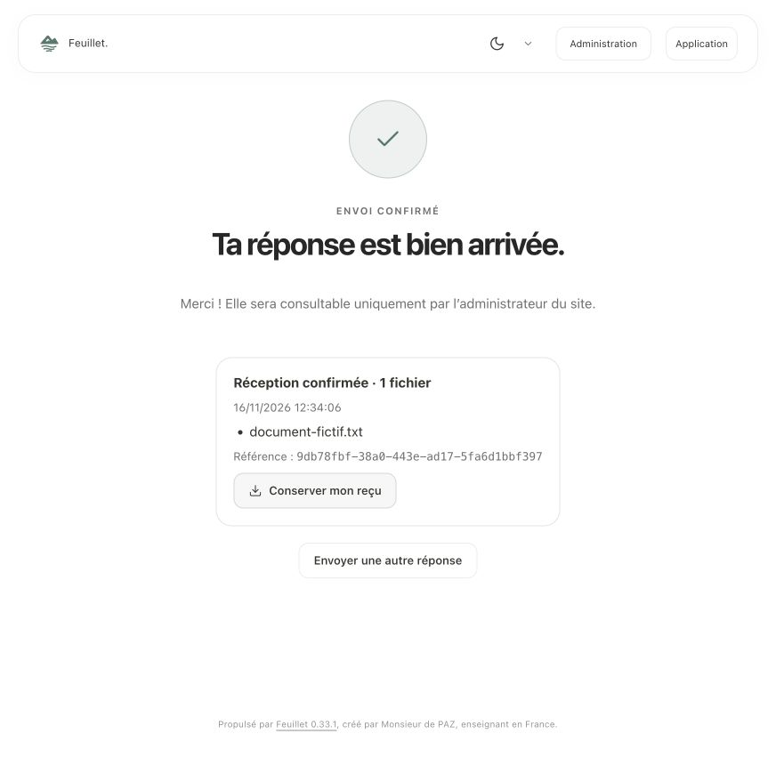

# Fiabilité des dépôts de formulaires — 0.33.1

## Ce qui confirme un dépôt

L’ajout d’un fichier dans le formulaire prépare une pièce jointe. Il faut ensuite envoyer la réponse. La confirmation affiche désormais un numéro de reçu, une date, le nombre de fichiers reçus et leurs noms. Le bouton **Conserver mon reçu** télécharge ces informations en texte ; il ne contient aucun lien public vers les documents.

Le serveur vérifie les pièces jointes puis valide la transaction SQL avant de répondre. L’interface exige `ok: true` et un reçu correspondant au formulaire, à la tentative et au nombre de fichiers. Une réponse de session, une réponse vide ou un reçu provenant d’une autre tentative n’affichent jamais le succès. Une coupure réseau peut laisser un dépôt enregistré sans confirmation visible : réessayer avec la même tentative retourne le reçu initial, sans doublon. Modifier le contenu crée une autre tentative.

## Contrôler une base

Depuis les paramètres d’une base, **Réception des fichiers → Vérifier les pièces jointes** affiche les pièces jointes rattachées, celles qui sont en attente et celles dont la ligne n’existe plus. Les fichiers disponibles sans ligne peuvent être téléchargés par l’administrateur. Le contrôle ne restaure ni ne reclasse automatiquement des réponses. L’inventaire est borné à 5 000 fichiers ; un signal l’indique si cette limite est atteinte.

`GET api.php?action=form_delivery_audit&id=<base>` fournit cet inventaire à l’administrateur uniquement. Il inclut l’existence des lignes des journaux et le nombre de fichiers du stockage sans métadonnées. Aucune liste de noms physiques, session, clé SQL ou empreinte de session n’est exposée. Un compteur de fichiers sans métadonnées ne signifie pas qu’ils proviennent nécessairement d’un formulaire.

## Conservation et récupération

À partir de cette version, `storage/form-submissions/<form-id>/<request-id>.json` conserve une copie privée de la réponse et les métadonnées des fichiers, écrite atomiquement avant la validation SQL. Le numéro de reçu correspond à la ligne SQL ; l’existence de cette ligne détermine la validation. Un journal peut donc documenter une tentative interrompue avant le commit : ne jamais l’interpréter seul comme une preuve de réception validée.

Les journaux sont hors de `public/`, avec dossiers 0700 et fichiers 0600, et ne font pas partie des releases. Ils ne sont pas supprimés automatiquement. Ils contiennent des données personnelles : appliquer à leur archivage et leur suppression la même politique qu’aux réponses. **Sauvegarder aussi `storage/form-submissions/` avec le stockage FTP.** L’export portable comprend les réponses SQL et médias actuels ; les journaux indépendants nécessitent cette copie du stockage. Les mises à jour conservent le stockage.

Les envois non finalisés restent soumis à l’expiration existante de 24 heures. Les pièces jointes des réponses validées ne sont pas supprimées par cette expiration. Les anciennes réponses n’ont pas de journal rétroactif : le correctif ne peut pas recréer des fichiers absents.

## Réseau partagé

Les limites sont de 20 ajouts de pièces jointes et 40 soumissions par session et formulaire sur 10 minutes, complétées par une limite de réseau de 600 ajouts / 1 200 soumissions. Les quotas existants de 10 pièces jointes en attente par session, 200 Mo en attente et 1 Go par formulaire restent appliqués. Cela permet les dépôts simultanés depuis une salle informatique sans supprimer les contrôles anti-abus.

## En cas d’incident

1. Conserver une sauvegarde SQL et une copie du stockage avant toute réparation.
2. Comparer les lignes et la bibliothèque avec l’inventaire des dépôts ; télécharger les fichiers encore présents.
3. Comparer les journaux privés avec les lignes SQL, puis les sauvegardes de mise à jour et de l’hébergeur.
4. Examiner les logs HTTP/PHP à l’heure du dépôt : distinguer chargement du formulaire, ajout de fichier et soumission finale. Un code 200 ancien sans identifiant de reçu ne prouve pas le contenu d’une réponse. L’absence de requête dans les logs consultés ne permet pas, à elle seule, d’identifier ce qui s’est produit sur le poste client.
5. Ne pas promettre une récupération tant que les octets des documents n’ont pas été retrouvés. Ne pas déduire la classe ou l’auteur d’un fichier sans vérification.

Les tests `tests/form-delivery.py` utilisent exclusivement des données fictives, sur SQLite et MySQL. Ils vérifient notamment 24 sessions derrière une IP, les reçus, les rejeux, l’isolation de session, les médias manquants, les erreurs de journal et l’inventaire sans mutation. `tests/frontend/form-delivery.ts` vérifie le refus des confirmations incomplètes ou incohérentes.
