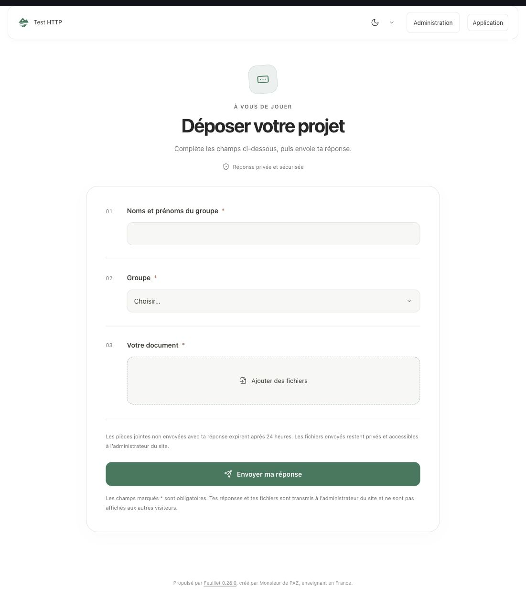
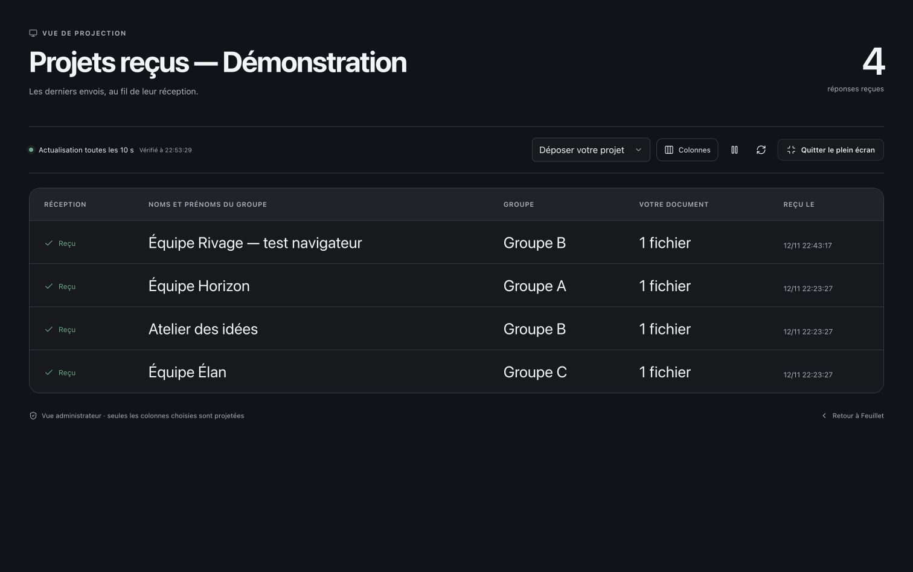

# Feuillet 0.28 — Formulaires et réceptions en direct

## Un formulaire plus agréable à remplir

Le formulaire commence par un squelette animé au lieu d’afficher l’accueil générique et deux grands noms Feuillet. Le nom du carnet reste dans la barre du haut. Les questions disposent d’espaces confortables, de repères numérotés et d’une zone d’ajout de fichiers lisible. L’envoi affiche une confirmation dédiée. Les thèmes clair, sombre et OLED sont conservés ; les animations respectent la préférence de réduction des mouvements.

Un chargement trop long propose **Réessayer**. Les envois ne sont jamais relancés automatiquement, afin d’éviter des réponses en double. Les liens des formulaires existants restent valides.

## Projeter les projets reçus

Dans **Bases de données**, choisir une base puis **Projeter les réponses**. Depuis un bloc formulaire de l’éditeur, ce bouton ouvre directement le filtre du formulaire concerné.

La fenêtre propose :

- Les 200 dernières lignes, avec un compteur du nombre total reçu.
- Un filtre par formulaire ou l’ensemble des lignes de la base.
- Le choix des colonnes visibles ; seul le premier Titre, ou à défaut Texte, est choisi initialement.
- Une actualisation toutes les dix secondes quand la fenêtre est visible, sans rechargement complet.
- Une mise en évidence des nouveaux envois, une pause, un rafraîchissement manuel et un plein écran.

La session administrateur est obligatoire. Les fichiers sont représentés par leur nombre, sans lien ni ID. Les colonnes masquées ne sont pas renvoyées par l’API de projection. Les relations et valeurs calculées restent dans les vues habituelles de la base. Le choix de ce qui est montré au vidéoprojecteur revient à l’administrateur ; les réponses restent privées sur le site.

## Des cartes et boutons personnalisables

Le bloc qui ouvre un formulaire utilise une carte compacte avec une icône, les champs attendus et un bouton visible. Dans l’éditeur, **Apparence du bouton** règle son style et sa taille.

Les boutons de contenu disposent également de ces réglages dans **Présentation** : **Doux**, **Accentué**, **Contour**, **Discret**, et trois tailles **Compact**, **Standard**, **Grand**. Les styles utilisent le thème courant et le même CSS dans l’éditeur et en lecture publique. Les icônes restent modifiables avec l’outil existant.

## Aperçus sur données fictives

## Installation et vérifications

Installer 0.28.0 depuis **Réglages & sauvegardes → Mises à jour**, puis recharger les onglets déjà ouverts. Pour une installation manuelle, conserver `config.php` et tout `storage/`, et envoyer la distribution complète compilée. Aucune migration de base n’est nécessaire pour ces fonctionnalités.

Tests HTTP sur installations isolées SQLite et MySQL, tests frontend, lecture publique et permissions, installation, sauvegarde/copie de blocs et PWA. Essais dans le navigateur intégré : formulaire avec fichier fictif, confirmation, apparition automatique dans la projection, choix de colonnes et plein écran. Aucun envoi n’a été effectué sur le formulaire de production.

Voir [Bases et formulaires](BASES-ET-FORMULAIRES.md), [Architecture](ARCHITECTURE.md) et [Maintenance](MAINTENANCE.md).
