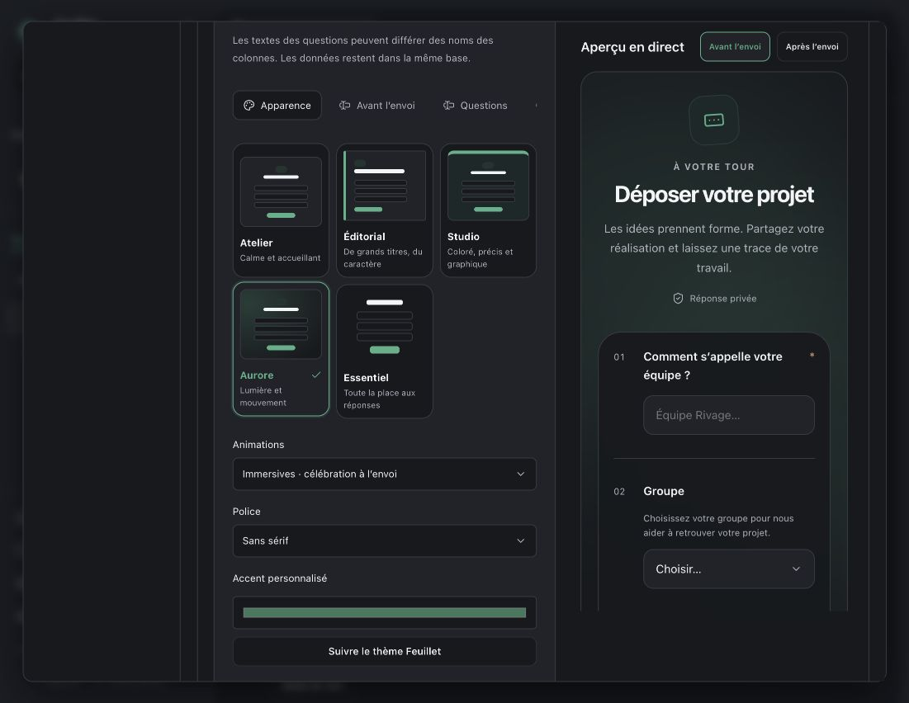
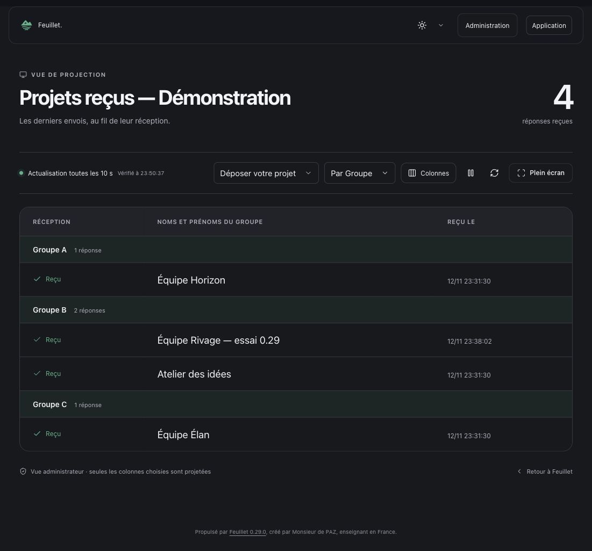

# Feuillet 0.29 — Vos formulaires, votre style

## Le texte des boutons

Sur un bloc formulaire, ouvrir **Apparence du bouton → Texte du bouton**. Le libellé est propre à ce bloc ; un champ vide reprend le libellé configuré dans le formulaire.

Dans le concepteur du formulaire, **Avant l’envoi** règle le bouton d’ouverture utilisé par défaut sur les pages, le bouton de validation, le texte pendant l’envoi et le bouton d’ajout de fichiers. Les boutons de liens conservent leur champ **Texte du lien** dans **Présentation**.

## Regrouper les fiches et les réceptions

Dans une base, choisir **Grouper → Regrouper par** puis une propriété. Chaque groupe possède un compteur et peut être replié. Tri et filtres continuent de s’appliquer. Les vues table, galerie et graphique sont prises en charge ; une vue enregistrée dans une page conserve son regroupement en lecture publique, sur les seules données autorisées.

Dans la projection, utiliser **Regrouper les réponses par**. Le contrôle reste actif pendant les actualisations de dix secondes. Les compteurs de groupe portent sur les lignes affichées, au maximum les 200 dernières ; le compteur général porte sur toutes les réponses du filtre. Le champ de regroupement est visible dans les en-têtes même s’il n’est pas ajouté comme colonne.

Les valeurs vides forment un groupe « Non renseigné ». Zéro et Non restent des valeurs. Les listes à plusieurs choix sont regroupées par combinaison exacte, indépendamment de l’ordre des choix, sans dupliquer les lignes. Fichiers et relations ne sont pas des clés de regroupement.

## Un studio avec aperçu en direct

Ouvrir **Bases de données → Formulaires → Configurer**, ou le bouton **Configurer** d’un bloc formulaire. L’aperçu peut afficher l’état avant ou après l’envoi ; il reste à côté des réglages lorsque la largeur le permet. Aucune réponse n’est envoyée depuis cet aperçu.

Cinq modèles sont proposés :

| Modèle | Présentation |
|---|---|
| Atelier | Carte douce, équilibrée et familière |
| Éditorial | Typographie expressive, alignement à gauche et traits fins |
| Studio | Entête teinté et repères graphiques |
| Aurore | Halos lumineux et profondeur légère |
| Essentiel | Une présentation discrète, sans carte superflue |

Le choix d’un modèle propose une police et un alignement ; ces choix restent modifiables. Couverture importée ou issue de la bibliothèque, police, accent, densité, alignement et numérotation sont réglables par formulaire. L’accent dispose de variantes dérivées pour garder un contraste lisible en clair, sombre et OLED, sans modifier la couleur choisie.

### Avant, pendant et après l’envoi

Les réglages comprennent les petits titres, descriptions, mentions, textes de carte, boutons, indication de transmission, informations sur les pièces jointes, bas de formulaire, titre et message de confirmation. Il est possible d’autoriser ou de masquer le bouton pour recommencer. Les textes facultatifs peuvent être laissés vides.

Chaque question dispose de son propre libellé, d’une consigne, d’un exemple et d’un caractère obligatoire. Ces réglages ne renomment pas la colonne de la base et ne modifient pas les autres formulaires. Les types de champs et leurs choix proviennent toujours de la base. Les textes sont affichés comme du texte, avec retours à la ligne, sans code HTML exécutable. Les messages techniques de validation et les crédits de Feuillet restent gérés par le logiciel.

### Animations

Choisir **Sans animation**, **Douces** ou **Immersives**. Le mode immersif ajoute une arrivée progressive des questions, des halos mobiles sur Aurore et une célébration brève après une réponse confirmée par le serveur. La préférence système de réduction des mouvements désactive les effets. Une animation ne retarde jamais l’envoi ou sa validation.

## Aperçus sur données fictives

## Données et mise à jour

Les formulaires existants conservent leurs URL, leurs champs et leurs réponses. Une migration ajoute une colonne JSON de configuration ; elle est idempotente et testée avec des requêtes concurrentes sur SQLite et MySQL. Les sauvegardes et copies indépendantes conservent les réglages et recréent les références de questions, couvertures et regroupements. Les copies importées sont privées avec de nouveaux liens.

Publier un formulaire rend sa couverture accessible, y compris si la base reste privée. Cela ne rend jamais publiques les réponses ou leurs pièces jointes. Les libellés de questions exclues ne sont pas renvoyés par l’API publique du formulaire.

Installer la **0.29.0** depuis les mises à jour de Feuillet, puis recharger les onglets ouverts. Pour une intervention FTP, utiliser la distribution complète et conserver `config.php` ainsi que tout `storage/`. Garder la sauvegarde créée avant la mise à jour.
