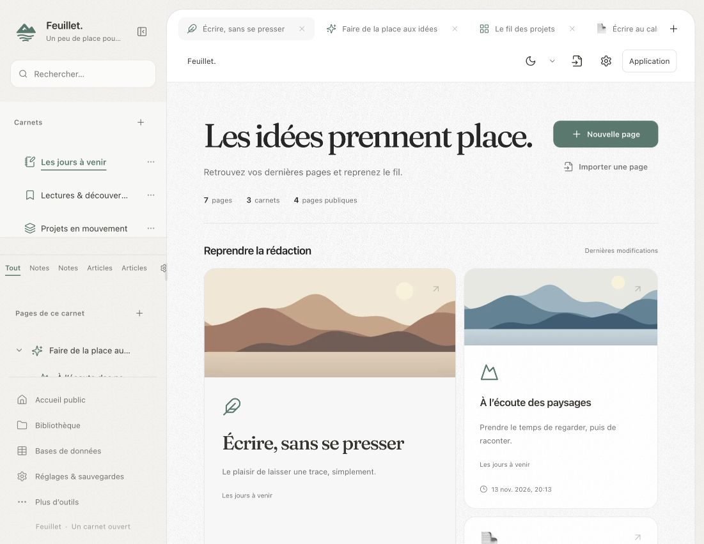
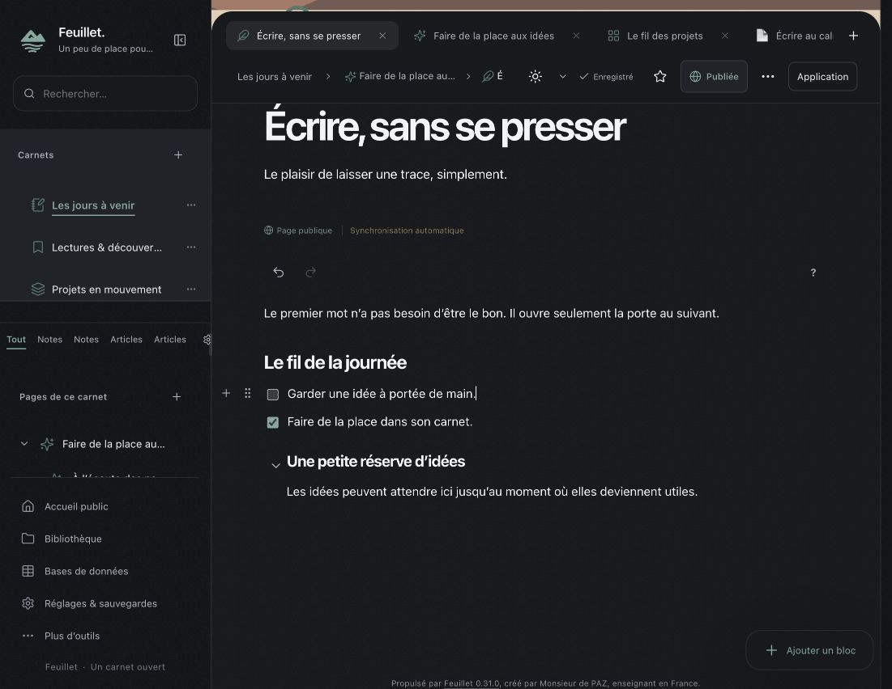

# Feuillet 0.31 — Rivage, une interface plus sereine

> **Correctif 0.31.1** : les pages claires sont désormais blanches (`#FFFFFF`) et le grain est retiré de toutes les surfaces. Les détails ci-dessous décrivent la version initiale 0.31.0.

Cette version réunit la direction graphique validée pendant les essais locaux et les derniers correctifs d’écriture. Aucun changement de base de données ni réimportation des pages n’est nécessaire.

## Une feuille plus agréable

L’accueil, les cartes, onglets, réglages, menus et outils flottants partagent des proportions et des espacements plus cohérents. Les grandes entrées de l’accueil utilisent Fraunces ; les documents conservent leur police. Les variantes claire, sombre et OLED gardent leurs contrastes.

Le fond des feuilles claires est **`#FBFBFB`**. Un grain statique fin distingue les pages, le fond latéral et les cartes. Les trois textures pèsent environ 40 Ko au total, sont disponibles hors connexion et ne nécessitent aucun calcul de bruit en continu. Elles ne recouvrent ni les photos ni les commandes.

Les sélections d’onglets et de réglages se déplacent doucement. Les menus et blocs accompagnent les actions volontaires. Écrire, appuyer sur Entrée, scinder ou fusionner une liste et utiliser Retour arrière reste immédiat, sans animation de ligne. Commencer à écrire interrompt aussi une animation d’arrivée de page encore active. La réduction des mouvements du système est respectée.

## Des cases à cocher accessibles

La poignée d’un paragraphe de liste se place désormais à gauche de **la ligne entière**, au lieu de prendre la case à cocher ou la puce pour emplacement. Un espace de huit pixels sépare la poignée de la ligne ; les listes imbriquées suivent la même règle. Le placement compact sur mobile est conservé.

Le test dans le navigateur intégré a confirmé l’absence de chevauchement et un écart de 12 px entre la poignée et la première case de démonstration. Le clic sur la case fonctionne sans ouvrir le menu de bloc.

## Une icône PWA sur fond blanc

Les icônes d’installation ont maintenant un fond blanc opaque et une marge autour de la montagne et du lac : PNG de 192 et 512 pixels pour le manifeste, et icône Apple de 180 pixels. Le dessin reste dans la zone centrale d’une icône Android masquable. Le logo dans l’interface et le favicon conservent leur présentation.

Pour une installation déjà présente sur l’écran d’accueil, la prise en compte de l’icône dépend du système. Si l’ancienne icône persiste, retirer le raccourci puis réinstaller Feuillet depuis le navigateur.

## Aperçus sur données fictives

### L’accueil clair

### L’écriture en mode sombre

### L’icône d’installation

## Installation et mise à jour

Installer **0.31.0** depuis les réglages de mise à jour, ou télécharger **Feuillet-0.31.0.zip** dans la release GitHub. Utiliser le paquet compilé, plutôt que l’archive automatique « Source code ».

Pour un transfert manuel, remplacer le code et ses ressources ensemble en conservant `config.php` et tout `storage/`. Inclure `public/rivage.css`, les textures, les icônes PWA et `update-manifest.json` de cette version. Ne pas relancer l’installateur. Recharger ensuite les onglets ouverts.

Le site OVH de l’utilisateur n’est pas mis à jour pendant la préparation de la release. Voir [le guide OVH](INSTALLATION-OVH.md), [la procédure de mise à jour et restauration](MISES-A-JOUR.md) et [la charte Rivage](INTERFACE-RIVAGE.md).

## Validation

Les contrôles portent sur les documents et commandes réels de l’éditeur, la navigation publique et son cache, le partage, les nouvelles ressources PWA, l’installation et les mises à jour dans des copies jetables. Le test d’icône contrôle les dimensions, l’opacité, la marge blanche et la zone sûre de masquage. Les vérifications de publication excluent les fichiers privés et les données locales du dépôt et du paquet.
