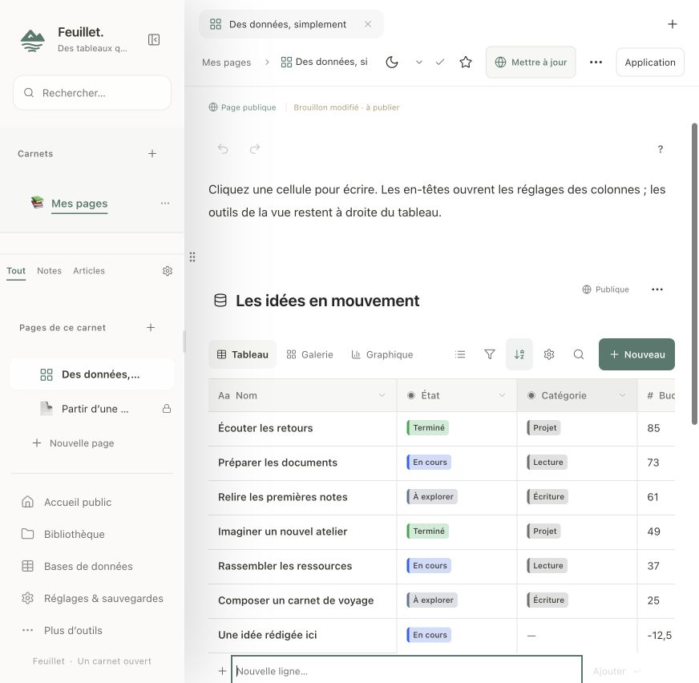

# Feuillet 0.33 — Vos bases, directement dans la page

L’affichage Tableau se concentre désormais sur les lignes et les colonnes.
Les actions courantes sont à portée de clic, sans aller modifier la base dans
un autre écran puis revenir dans votre page.

## Commencer

Tapez `/base` ou choisissez **Base de données** dans l’ajout de blocs. Recherchez
une base existante, ou donnez un nom et créez une base vide. La colonne **Nom**
est prête ; la base commence en privé. Même sans ligne, les en-têtes restent
visibles et permettent d’ajouter des propriétés.

## Remplir et modifier

- Cliquez une cellule de texte, nom, nombre, date, e-mail, téléphone ou URL pour
  la modifier directement. **Entrée** ou sortir de la cellule enregistre ;
  **Tab/Maj+Tab** passe à une autre cellule ; **Échap** annule la saisie.
- Une case se coche en un clic ; un choix unique s’enregistre à la sélection.
  Fichiers, relations et choix multiples disposent d’un éditeur spécialisé.
- **Nouvelle ligne…**, en bas du tableau, permet de saisir un nom et d’ajouter
  avec Entrée. Les autres champs obligatoires ouvrent la fiche complète en
  conservant ce nom. **Nouveau** rejoint cette zone, ou ouvre une fiche dans
  les autres types de vue.
- Les écritures sur une même ligne sont ordonnées. Un conflit conserve la
  saisie et propose de la récupérer ; les versions du serveur sont vérifiées.

## Régler la vue

Les trois types de vue — **Tableau, Galerie, Graphique** — sont à gauche.
À droite : regroupement par propriété, filtres, tri, propriétés visibles,
recherche et ajout. Les réglages s’ouvrent au-dessus du tableau ; Échap ferme
un sélecteur imbriqué avant le panneau situé derrière lui.

Les filtres se combinent avec ET. Un tri est actif à la fois. Les présentations
restent propres à chaque bloc ; cette version ne crée pas un système de vues
nommées multiples. Les données et propriétés restent communes à la base.

Cliquez l’en-tête d’une colonne pour modifier sa propriété, trier, regrouper ou
masquer la colonne. Le bouton **+** ajoute une propriété. Relations, formules
et agrégations conservent leur fonctionnement et leur validation habituels.

## Régler la base et ses formulaires

Le nom du tableau et le bouton **…** ouvrent les paramètres de la base dans la
page : nom, accès privé/public, formulaires, actualisation et export CSV. Le
panneau de propriété ou de fiche se ferme pour retrouver le même tableau.

Rendre la base publique ne publie pas la page. Pour les visiteurs, les deux
conditions sont nécessaires : base publique et page publiée. Les lignes
privées et toutes les réponses aux formulaires, avec leurs pièces jointes,
restent privées. Le changement de présentation suit la sauvegarde et les
réglages de publication de votre page.

## Installer

Installer **0.33.0** depuis Réglages & sauvegardes → Mises à jour, puis recharger
les onglets. L’archive compilée contient aussi `database-workbench.css` et le
nouveau manifeste ; transférer l’ensemble pour une mise à jour manuelle, en
conservant **config.php et tout storage/**. Aucune migration SQL spécifique ni
nouvelle dépendance de production.

Voir [l’architecture](ARCHITECTURE.md), les [tests](TESTS.md) et
[l’étude d’ergonomie](BASES-INTERFACE-0.33.md).

## Correctif 0.33.2

Dans le tableau, les pièces jointes gardent une largeur lisible à côté de leur bouton d’édition. Les noms longs s’abrègent avec des points de suspension ; le nom complet apparaît au survol. Aucun renommage de fichier ni changement SQL.

Validation : compilation TypeScript/Vite et navigateur intégré avec un nom long, avec et sans espaces : cellule de 274 px, nom sur une ligne, bouton de 28 px et hauteur de ligne de 52 px dans la démonstration.

## 0.33.3 — Lecture et aperçu des images

Le fond de la page et celui de sa racine sont harmonisés, sans bande sombre au-dessus du bandeau flottant. Le bandeau laisse davantage voir le contenu défilant à travers un flou renforcé. Les images publiques, couvertures et vignettes s’ouvrent dans un aperçu sur fond flouté ; un clic extérieur, la croix ou Échap referment l’aperçu sans navigation ni perte du défilement. Les commandes d’édition des images restent disponibles dans l’éditeur.

La source et la licence des couvertures restent dans les données et sont affichées dans l’aperçu ouvert par clic sur la couverture. Elles ne prennent plus de place sous l’icône de la page ; elles restent visibles à l’impression.

Validation navigateur avec une illustration fictive : racine et corps à rgb(23,25,29), corps positionné à 0, source masquée dans la page puis visible dans le dialogue, fermeture extérieure et Échap, défilement restauré.

## 0.33.4 — Bandeau plus transparent

Le bandeau supérieur du lecteur et de l’administration utilise désormais un fond à 42 % d’opacité (contre 62 % auparavant). Le flou de 26 px reste inchangé. Aucun changement de contenu ni de base de données.

### 0.33.5 — Galeries et largeur du bandeau

Un clic sur la miniature d’une galerie ouvre la page associée. Les images ordinaires et couvertures conservent leur aperçu agrandi. Sur ordinateur, le bandeau du lecteur reprend la largeur Compact ou Large de la page ; les marges adaptées aux mobiles sont conservées.

### 0.33.6 — Largeur du bandeau depuis les réglages généraux

Le bandeau du lecteur utilise le choix de largeur situé en bas de Réglages → Apparence (Confortable/Compact ou Large). Ce choix reste indépendant des éventuelles personnalisations de largeur propres aux pages. La navigation et le changement de thème le conservent. Le contenu des pages retrouve ses dimensions antérieures au correctif 0.33.5.
