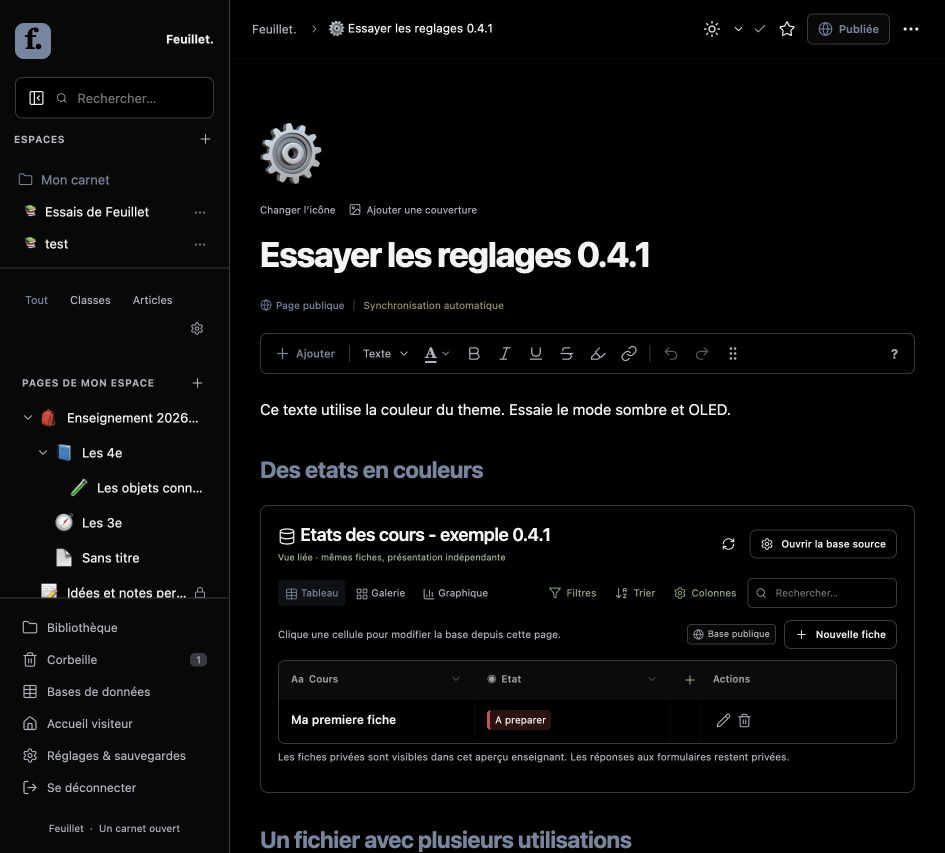

# Feuillet 0.4.1 — navigation, couleurs et utilisations

## Masquer la barre latérale

Un bouton visible à côté de **Rechercher…** replie la navigation. Un bouton dans l’en-tête la réaffiche. **Ctrl/Cmd + Maj + L** fait les deux opérations. Dans **Réglages & sauvegardes → Mon carnet**, choisir la lettre ou le chiffre du raccourci, ou le désactiver. Les modificateurs restent Ctrl/Cmd + Maj ; certains raccourcis réservés au navigateur ou au système peuvent être interceptés, et les boutons restent disponibles.

Le raccourci fonctionne aussi dans l’éditeur sans insérer de caractère. Sur mobile, il ouvre ou ferme le tiroir de navigation. Le choix de touche est conservé dans le carnet et sa sauvegarde ZIP ; le masquage lui-même est une préférence locale du navigateur. Le mode plein écran de page demeure distinct.

## Texte par défaut

La commande **Texte défaut** retire la couleur explicite de la sélection, sans enlever gras, italique, liens ou autres marques. Le texte hérite alors de la couleur du thème. La commande A « Défaut » utilise également cette couleur dans son aperçu et indique correctement la sélection du défaut.

Les anciennes marques `#37352F` correspondent à l’ancien défaut : elles sont interprétées comme une couleur de thème dans l’éditeur et le lecteur, puis retirées lors de l’enregistrement. Les autres couleurs explicites, dont le noir `#000000`, restent inchangées. L’export PDF conserve son propre rendu sur fond de papier.

## Variantes automatiques de l’accent

L’accent choisi dans les réglages généraux, ou dans l’apparence d’une page, reste la couleur source. Le mode clair l’utilise telle quelle. Les modes sombre et OLED en dérivent automatiquement une variante de la même teinte et saturation, en ajustant sa luminosité lorsque nécessaire. Le contrôle d’apparence montre les trois variantes avant leur utilisation.

Les titres, liens, menus et contrôles emploient l’accent dérivé. Les boutons remplis et la marque Feuillet utilisent automatiquement un texte noir ou blanc selon le contraste avec leur fond, et leur survol conserve ce contraste. L’accent est aussi recalculé quand le visiteur change son thème personnel. L’éditeur et le lecteur emploient le même calcul ; la couleur source enregistrée et la sauvegarde ne sont pas modifiées.

Le calcul vise au moins 4,5:1 sur les fonds standards du mode choisi, y compris les surfaces de menus. Cette vérification ne constitue pas une certification d’accessibilité de toute l’interface ; un assemblage de fonds personnalisés très clairs et très sombres peut exiger des choix supplémentaires. Les couleurs explicites du texte, des états ou d’une icône restent des choix distincts de l’accent général.

## Sous-pages publiques automatiquement

Activer **Publier automatiquement les sous-pages des pages publiques** dans les réglages du carnet. L’enregistrement de ce réglage publie toutes les sous-pages existantes des parents publics actifs, jusqu’aux niveaux les plus profonds. Les futures créations et les déplacements ou restaurations sous un parent public héritent aussi de cette visibilité. Le réglage ne dépend pas de l’option qui synchronise les modifications des pages déjà publiques.

Une sous-page ne peut plus être rendue privée individuellement tant que son parent est public et ce réglage actif. Rendre le parent privé retire toute sa branche. Désactiver le réglage permet de choisir à nouveau la visibilité, sans retirer automatiquement les pages déjà publiées. Une racine privée n’est pas publiée par l’activation, et les réponses aux formulaires demeurent privées. Les modifications en brouillon d’un enfant déjà publié ne sont pas écrasées ni republiées lors de l’activation.

Le réglage est **désactivé par défaut**, afin de conserver la confidentialité des sous-pages existantes sur une installation mise à jour. Dans la prévisualisation, les cours existants n’ont pas été republiés pendant les tests. Les essais d’activation utilisent des installations jetables contenant seulement des exemples fictifs.

L’héritage suit l’arborescence parent/sous-page. Un simple lien ou une carte vers une autre racine privée ne la publie pas. Les bases et formulaires gardent leurs règles d’accès distinctes.

## Couleurs des états

Ouvrir le menu de la propriété, puis **Modifier la propriété**. Pour un choix unique — notamment un état — ou un choix multiple, attribuer une couleur à chaque libellé. Le bouton **Par défaut** retire cette couleur. Les étiquettes conservent un texte lisible dans les trois thèmes, avec un fond teinté et une bordure de la couleur choisie.

Les couleurs sont communes à toutes les vues de la base et apparaissent dans les tables et galeries publiques. Elles sont sauvegardées et restaurées avec les propriétés. Le serveur accepte seulement des couleurs hexadécimales à six chiffres et des libellés présents dans les choix. Les formules et les valeurs des fiches ne sont pas modifiées.

## Utilisations des médias

Dans **Bibliothèque**, cliquer **Utilisations** à côté d’un fichier. L’inventaire indique son accessibilité réelle aux visiteurs et les références dans :

- Le contenu, la couverture ou l’icône des pages, avec la distinction entre brouillon et snapshot publié.
- Les cartes de galerie et les bases intégrées : ce sont des références indirectes, même si une vue masque une colonne.
- Les fichiers des fiches de base, en distinguant les réponses privées de formulaires.
- Les anciennes versions, la corbeille, les pièces jointes en attente et l’icône globale du carnet.

Le titre d’une page est cliquable pour y revenir. Les anciennes versions sont toujours privées : leur présence explique qu’un fichier demeure référencé même s’il a été retiré du contenu actuel. Un fichier utilisé dans plusieurs lieux reste accessible s’il possède au moins un usage public autorisé. L’inventaire est limité à 200 résultats et indique lorsqu’il est tronqué ; il ne supprime aucun média. Les aperçus de galerie reflètent les métadonnées actuelles des pages liées, pas une archive complète des images de chaque ancienne galerie.

La route d’inventaire exige une session administrateur avant toute lecture de titres ou de références. Elle ne fournit pas le chemin du stockage et ne modifie pas les règles de téléchargement.

## Installation et contrôles

La mise à jour conserve `config.php` et `storage/`. Aucun VPS, nouvelle extension PHP ou migration destructrice n’est nécessaire. Les ressources du navigateur sont versionnées dans leurs URL pour charger le nouveau code après actualisation.

Les résultats et les limites des essais sont dans [TESTS.md](TESTS.md), et le contrat des nouveaux champs dans [API-CONTRACT.md](../API-CONTRACT.md).
