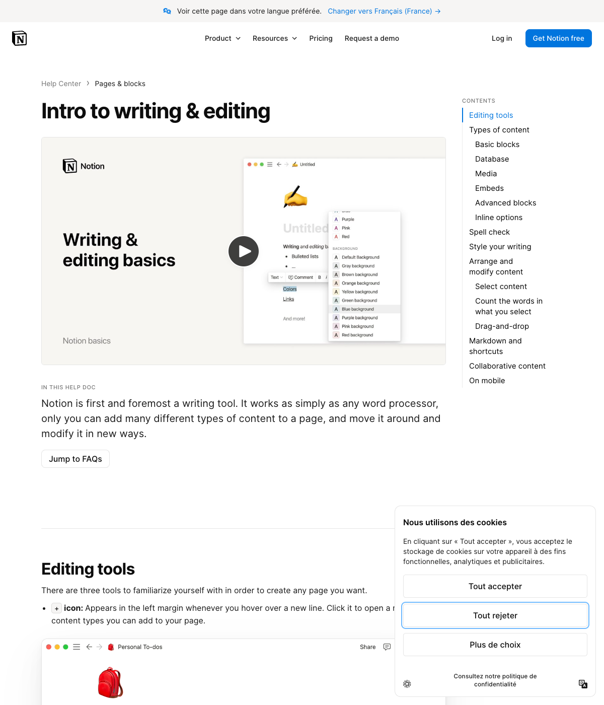

# Déplacement des blocs — référence Notion et REA

Observation réalisée le 14 octobre 2026 avec REA 6.4.0, issu de [morluto/rea](https://github.com/morluto/rea), selon son skill reverse-engineer-anything. Le scénario a ouvert la documentation officielle dans un Chrome isolé, sans compte, sans cookies, sans corps réseau et sans modification d’une page Notion.

## Comportements documentés

Le guide officiel [Writing & editing basics](https://www.notion.com/help/writing-and-editing-basics) décrit la poignée ⋮⋮ à gauche d’un bloc : glisser déplace le bloc, cliquer ouvre ses actions. Les lignes de texte, médias et autres blocs peuvent être déplacés dans une page. Les toggles contiennent d’autres contenus. Les [raccourcis](https://www.notion.com/help/keyboard-shortcuts) distinguent indentation et désindentation pour imbriquer un bloc ou le sortir de son parent.

## Observation et limites

REA a capturé la documentation publique et son arbre accessible, pas les gestes dans un éditeur authentifié. Evidence : ev_c5ca0dad1ac5e0059800c4d742dad9d550312886a3ea86bd9dfb07a6f6923a42. Les identités et limites figurent dans [le relevé compact](REA-BLOCS-PREUVES.json).

La ligne d’insertion, la décision d’entrer dans une section selon le pointeur et les raccourcis Alt + flèches décrits dans Feuillet sont des choix de reconstruction. Une identité complète de comportement avec l’éditeur propriétaire de Notion n’est pas démontrée. Aucune ressource propriétaire de l’éditeur n’est utilisée dans le logiciel.

## Implémentation Feuillet

Une poignée par bloc manipulable suit le survol, y compris dans les titres dépliables. Le clic garde le menu d’actions ; un déplacement de plus de cinq pixels commence le glissement. Un repère d’accent indique avant/après ou « Dans la section ». Les déplacements utilisent une seule transaction Tiptap/ProseMirror, conservent les marques, attributs et pièces jointes, et restent annulables. Un conteneur dont on sort le dernier bloc reçoit un paragraphe vide valide. Un bloc ne peut pas être déposé dans son propre contenu.
