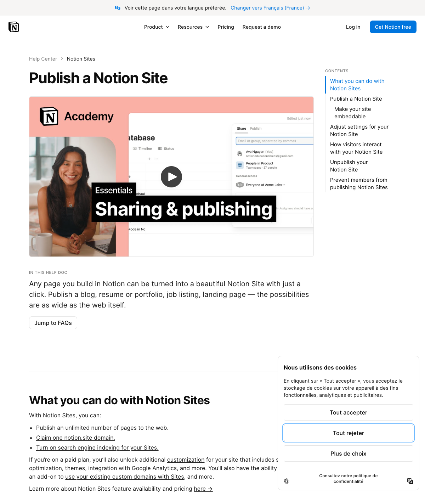

# Publication automatique — référence et preuve REA

Le 13 octobre 2026, la documentation primaire [Publier un site Notion](https://www.notion.com/help/public-pages-and-web-publishing) confirme que les modifications de contenu d’une page déjà publiée actualisent son site automatiquement. Elle décrit une première publication explicite dans le menu de partage et indique que cette publication concerne aussi les sous-pages. Cette référence concerne les modifications de contenu ; les réglages de présentation du site possèdent leur propre parcours, décrit dans [Personnaliser son site](https://www.notion.com/help/edit-and-customize-your-notion-sites).

REA **6.4.0**, installé depuis le projet [morluto/rea](https://github.com/morluto/rea), a réellement observé cette documentation publique. Preuve : `ev_469f8f80dc1a64f58c2381c78a37602ac8d8fc14b37bb2dcc7c085451b45ae10`. Le scénario lance un Chrome temporaire isolé, ouvre la documentation, attend 1,5 seconde puis capture l’URL, l’accessibilité et une image. Il ne connecte aucun compte, ne modifie aucune page et ferme son propre navigateur à la fin.

L’arbre accessible contient le court passage « the Site will update automatically ». C’est une **observation de documentation**, pas un test de propagation d’une édition privée Notion. Les preuves précédentes de la page Bessières sont détaillées dans [ANALYSE-NOTION.md](ANALYSE-NOTION.md). Elles établissent son rendu public, sans démontrer le mécanisme d’enregistrement.



Le relevé compact sans cookies, corps réseau ou texte complet est dans [REA-PUBLICATION-PREUVES.json](REA-PUBLICATION-PREUVES.json). Les paramètres et l’enveloppe d’origine restent dans `work/rea/publication-doc-scenario.json` et `work/rea/publication-doc-evidence.json`, hors distribution du logiciel.

## Comportement propre à Feuillet 0.4

Après une première publication, un enregistrement réussi d’une page publique remplace immédiatement sa version publiée. Titre, texte, couverture, position, icône et références de fichiers sont copiés dans la même transaction que le brouillon ; le numéro de version est identique. Une sauvegarde en conflit n’écrit aucune des deux versions. La disponibilité d’un média dépend des références de la version publiée.

La création d’une page ou d’un nouvel enfant reste privée. Sauvegarder son parent public ne publie pas cet enfant. L’action explicite **Publier** conserve son comportement de publication de l’arborescence existante ; passer une page en privé retire aussi ses descendants. Ce sont des règles de produit Feuillet, pas une promesse de parité intégrale avec Notion.

Le réglage global `notebook.auto_publish` est activé par défaut et peut être désactivé pour conserver un brouillon avant une publication manuelle. Le réactiver ne publie pas immédiatement les modifications en attente : elles seront publiées au prochain enregistrement d’une page déjà publique.

Les six tests de `tests/autopublish.py` vérifient ces contrats par HTTP sur des copies jetables SQLite et MySQL, ainsi que la visibilité des médias et le remappage de l’icône du carnet lors d’une restauration. Ils ne mesurent pas la latence de rafraîchissement d’un navigateur Notion ni celle d’un hébergement OVH réel.

## Reproduction de l’observation

Depuis la racine du dossier de travail :

```sh
work/rea/node_modules/.bin/rea capture-browser-scenario work/rea/publication-doc-scenario.json --format json
```

Chrome observé : `155.0.8059.39`. Capture SHA-256 : `8b6506a1bed7f8324a5351a061cc09fbcd3d8bc164ebf73682d2a43077bb2504`. Accessibilité SHA-256 : `293ed67bada9e64745e5e2790450b6977f6bce00f091a5e142fd2f8c9999c3b6`. La page et le navigateur peuvent évoluer ; une nouvelle observation produira de nouvelles empreintes.
